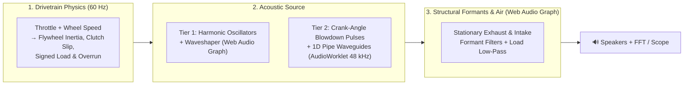

# Procedural Engine Audio From First Principles

A hands-on, two-part DSP & vehicle acoustics curriculum designed specifically for the **2D Kinematic Parking Simulator** (`Parking-`).

> **Philosophy:** Zero black-box libraries, zero pre-baked audio assets, and **you write 100% of the code**. Both chapters build from first-principles physics and mechanical intuition—assuming **no prior Digital Signal Processing (DSP) background**—and include scattered **"Pause & Think"** checkpoints so you can test your intuition before coding.

---

## How Tier 1 and Tier 2 Fit Together

Tier 1 is **not** throwaway work when you move to Tier 2. A realistic procedural engine has three stages:



- **In Tier 1 ([Chapter 1](./chapter_01_tier1_formants_and_drivetrain.md))**, you build **Stage 1 (Drivetrain & Load Physics)** and **Stage 3 (Subtractive Formant & Low-Pass Filtering)** while cleaning up the existing oscillator source.
- **In Tier 2 ([Chapter 2](./chapter_02_tier2_pulses_and_waveguides.md))**, you keep your Stage 1 Drivetrain and Stage 3 Formant body intact, and swap out Stage 2's continuous oscillators for a **48 kHz sample-by-sample crankshaft pulse & 1D acoustic waveguide synthesizer** inside an `AudioWorklet`.

---

## Chapters & Downloadable PDFs

You can read the guides in Markdown format directly in your editor or open the compiled publication-ready PDFs with high-resolution visual diagrams:

| Chapter | Markdown Guide | PDF (With Embedded Diagrams) | Key Topics |
| :--- | :--- | :--- | :--- |
| **Complete Volume** | — | **[`procedural_engine_sound_guide_complete.pdf`](./procedural_engine_sound_guide_complete.pdf)** | Both chapters combined into a single printable book. |
| **Chapter 1 (Tier 1)** | **[`chapter_01_tier1_formants_and_drivetrain.md`](./chapter_01_tier1_formants_and_drivetrain.md)** | **[`chapter_01_tier1_formants_and_drivetrain.pdf`](./chapter_01_tier1_formants_and_drivetrain.pdf)** | DSP basics, Biquad & formant filtering, Source-Filter model, Parking drivetrain & clutch flare. |
| **Chapter 2 (Tier 2)** | **[`chapter_02_tier2_pulses_and_waveguides.md`](./chapter_02_tier2_pulses_and_waveguides.md)** | **[`chapter_02_tier2_pulses_and_waveguides.pdf`](./chapter_02_tier2_pulses_and_waveguides.pdf)** | AudioWorklet 48 kHz loop, $720^\circ$ crank phase, Biphasic zero-DC blowdown wavelets, Cross-Plane V8 vs Flat-6 firing geometry, 1D pipe waveguides ($f_1 = c/4L$). |
| **Case Study: Boxer-6** | **[`case_study_boxer6_body_and_de_buzzing.md`](./case_study_boxer6_body_and_de_buzzing.md)** | — | Spectral evacuation across RPM, adding $60\text{–}400\text{ Hz}$ midrange body, $-24\text{ dB/oct}$ cascaded Butterworth rounding, and $\text{sech}^2$ turbulent intermodulation. |

---

## Embedded Visual Diagrams (`docs/diagrams/`)

- **Figure 1.1:** [Three-Stage Procedural Audio Architecture](./diagrams/arch_overview.png)
- **Figure 1.2:** [2nd-Order Low-Pass Filter Frequency Response & Q Values](./diagrams/ch1_lowpass_response.png)
- **Figure 1.3:** [Source–Filter Model (Harmonic Teeth × Stationary Cavity Formants)](./diagrams/ch1_formant_concept.png)
- **Figure 2.1:** [Zero-DC Asymmetric Exhaust Blowdown Pressure Wavelet](./diagrams/ch2_blowdown_wavelet.png)
- **Figure 2.2:** [Cross-Plane V8 Uneven Bank Spacing vs. Flat-6 Even Spacing Across $720^\circ$](./diagrams/ch2_firing_orders.png)
- **Figure 2.3:** [1D Digital Acoustic Waveguide with Inverting Open-Tailpipe Reflection](./diagrams/ch2_waveguide_loop.png)

---

## Useful Commands While Working

```bash
# Run headless Jest unit tests (Drivetrain & Audio state math)
npm test

# Serve the simulator & interactive Audio Tuner locally
npm start
# Simulator:   http://localhost:8080/index.html
# Audio Tuner: http://localhost:8080/src/audio_tuner.html
```
