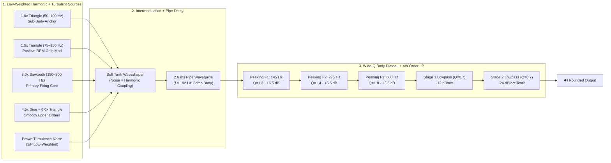

# DSP Case Study: Adding Acoustic Body & Eliminating Synth Buzz in the Boxer-6 Model

This guide explains the digital signal processing (DSP), physical acoustics, and psychoacoustics behind re-tuning the **Boxer-6 (`boxer_6_cayman`)** preset in [`src/ModularAudioEngine.js`](../src/ModularAudioEngine.js) so that the **$3{,}000\text{–}6{,}000\text{ RPM}$ midrange** transitions from a thin, buzzy synthesizer into a warm, rounded, full-bodied mechanical flat-six.

---

## 1. Diagnosis: Why Idle (`900 RPM`) Sounded Good While `3,000–6,000 RPM` Sounded Thin & Synthy

In harmonic synthesis, every oscillator tracks a multiple ($M$) of the crankshaft rotational frequency:
$$f_0 = \frac{\text{RPM}}{60}\;\text{Hz}, \qquad f_M = M \cdot f_0$$

When an engine revs from **$900\text{ RPM}$ ($f_0 = 15\text{ Hz}$)** up to **$4{,}500\text{ RPM}$ ($f_0 = 75\text{ Hz}$)**, every harmonic oscillator shifts upward in frequency by a factor of **$5\times$** (more than two full octaves).

### The "Spectral Evacuation" Problem in the Midrange
In our initial Boxer-6 patch, the lowest oscillator was the 3-cylinder bank firing order (**`1.5x`**), and the dominant oscillator was the 6-cylinder primary firing order (**`3.0x`**):

| Engine Order | Frequency at `900 RPM` Idle | Frequency at `4,500 RPM` Midrange | Frequency at `6,000 RPM` Upper-Mid |
| :--- | :---: | :---: | :---: |
| **`1.0x` (Crank / Block)** | *(Missing in v1)* | *(Missing in v1: $75\text{ Hz}$)* | *(Missing in v1: $100\text{ Hz}$)* |
| **`1.5x` (3-Cyl Bank)** | $22.5\text{ Hz}$ (Sub-bass) | $112.5\text{ Hz}$ *(Faded by `-0.15` RPM mod)* | $150.0\text{ Hz}$ *(Faded by `-0.15` RPM mod)* |
| **`3.0x` (6-Cyl Primary)** | $45.0\text{ Hz}$ (Deep bass) | **$225.0\text{ Hz}$** *(Walked into `330 Hz` scoop!)* | **$300.0\text{ Hz}$** *(Inside `330 Hz` `-4.5 dB` scoop!)* |
| **`4.5x` (3rd Bank Order)** | $67.5\text{ Hz}$ (Bass) | $337.5\text{ Hz}$ *(Inside `330 Hz` scoop!)* | $450.0\text{ Hz}$ (Mid) |
| **`6.0x` (2nd Firing Order)** | $90.0\text{ Hz}$ (Upper bass) | $450.0\text{ Hz}$ (Mid + bright sawtooth harmonics) | $600.0\text{ Hz}$ (Upper-mid) |

Look at what happened as the engine entered $3{,}000\text{–}6{,}000\text{ RPM}$:
1. **At `900 RPM` Idle**, `1.5x` ($22.5\text{ Hz}$), `3.0x` ($45\text{ Hz}$), `4.5x` ($67.5\text{ Hz}$), and `6.0x` ($90\text{ Hz}$) were all packed tightly into the $22\text{–}185\text{ Hz}$ bass/chest register, and the low-pass filter at $260\text{ Hz}$ shaved off everything above the 5th harmonic. That produced a dense, warm, rounded pressure wave.
2. **At `3,500–6,000 RPM`**, all of those oscillators migrated upward out of the bass register **simultaneously**:
   - Nothing remained in the **$50\text{–}110\text{ Hz}$ sub-bass/chest band**.
   - The `1.5x` order ($88\text{–}150\text{ Hz}$) was actively attenuated by a negative `rpmModGain: -0.15`.
   - Worse yet, the primary `3.0x` firing frequency ($175\text{–}300\text{ Hz}$) and `4.5x` order ($262\text{–}450\text{ Hz}$) walked directly into our **`330 Hz` (`-4.5 dB`) anti-boxiness notch**!
   - Meanwhile, the high-frequency formant at **`1,150 Hz` (`+8.5 dB`, narrow `Q = 4.2`)** was boosting the upper sawtooth harmonics right in the human ear's most sensitive $1\text{–}3\text{ kHz}$ band (Fletcher–Munson equal-loudness peak).

**Psychoacoustic result:** When energy in the $60\text{–}350\text{ Hz}$ "chest/body" region drops out while narrow $1\text{–}3\text{ kHz}$ phase-locked overtones are boosted, the brain immediately stops hearing a heavy cast-aluminum engine block and hears a thin, nasal synthesizer lead.

---

## 2. How We Added Body: Four Theoretical Mechanisms

To give the $3{,}000\text{–}6{,}000\text{ RPM}$ range physical weight and "chest," we applied four structural DSP changes:

### 2.1 Sub-Harmonic Anchoring (`1.0x` Crank Order + Positive-Scaling `1.5x` Bank Order)
Even in a horizontally opposed 6-cylinder engine where primary reciprocating forces cancel, the **1st engine order ($1.0\text{E} = \text{RPM}/60$)** and **single-bank 3-cylinder collector order ($1.5\text{E}$)** radiate strongly through crankshaft torsion, flywheel coupling, and unequal path lengths from the left and right exhaust banks:
- At $3{,}000\text{–}6{,}000\text{ RPM}$, **`osc_block10` (`1.0x` Triangle)** sits at **$50\text{–}100\text{ Hz}$**, continuously anchoring the sub-bass chest thump after `3.0x` has climbed above $150\text{ Hz}$.
- **`osc_bank15` (`1.5x` Triangle)** sits at **$75\text{–}150\text{ Hz}$** and now uses a **positive** `rpmModGain: +0.10` and `throttleModGain: +0.30` (reaching a gain of `0.84–0.94` under mid-RPM load).
- Because both `1.0x` and `1.5x` use **`triangle`** waveforms (whose odd harmonics decay rapidly as $1/n^2$, or $-12\text{ dB/octave}$), they inject massive fundamental energy into $50\text{–}180\text{ Hz}$ without polluting the $1\text{–}4\text{ kHz}$ high end.

### 2.2 Wide-$Q$ Overlapping Formant Plateau (`145 Hz` + `275 Hz`) Instead of a Mid-Scoop
For a 2nd-order `peaking` biquad filter, the $-3\text{ dB}$ bandwidth $\Delta f$ and the time-domain ringing decay time constant $\tau$ are governed by the quality factor $Q$:
$$\Delta f = \frac{f_c}{Q}, \qquad \tau \approx \frac{Q}{\pi f_c}$$

- **High $Q$ ($Q > 3.5$)**: Narrow bandwidth, long ringing decay $\tau$. When an engine harmonic sweeps across a narrow, high-gain peak, it suddenly "whistles" and rings like a plucked resonant filter.
- **Low/Broad $Q$ ($Q \approx 1.3\text{–}1.5$)**: Wide bandwidth ($\Delta f \approx 110\text{–}200\text{ Hz}$), fast damping (almost zero ringing).

By removing the `-4.5 dB` notch at `330 Hz` and placing two broad, overlapping positive formants at **`145 Hz` (`+6.5 dB, Q = 1.3`)** and **`275 Hz` (`+5.5 dB, Q = 1.4`, shifting up to `~350 Hz` under load/RPM)**, their transfer functions sum into a **smooth, continuous $+5\text{ to }+6.5\text{ dB}$ "body dome" spanning $80\text{ Hz} \to 450\text{ Hz}$**. Across the entire $3{,}000\text{–}6{,}000\text{ RPM}$ sweep, `1.0x`, `1.5x`, and `3.0x` ride directly across the top of this warm plateau instead of falling into a scoop.

### 2.3 Short Acoustic Pipe Waveguide (`2.6 ms` Inverting Feedback Delay)
Real exhaust headers and mufflers are 1D acoustic pipes where pressure waves reflect off open/expansion boundaries with a phase inversion (negative reflection coefficient $R < 0$). Inserting `delay_pipe` ($\tau_d = 2.6\text{ ms}$, `feedback = -0.28`, `mix = 0.30`) after the waveshaper introduces a transfer function with periodic spectral reinforcement at odd multiples of:
$$f_1 = \frac{1}{2 \tau_d} = \frac{1}{2 \times 0.0026\text{ s}} \approx 192\text{ Hz}$$
This naturally thickens the $150\text{–}250\text{ Hz}$ lower midrange while introducing frequency-dependent phase dispersion that breaks up the flat, "2D" sound of phase-locked oscillators.

---

## 3. How We Removed Buzziness & Rounded the Waveform

### 3.1 What "Buzziness" Actually Is in the Time and Frequency Domains
A waveform sounds "buzzy" (rather than "rounded") when it contains **instantaneous vertical step discontinuities** (high first derivative $|dx/dt|$) in the time domain. By Fourier's theorem, a waveform with a sharp jump discontinuity decays slowly in frequency as $\frac{1}{n}$ (**$-6\text{ dB/octave}$**), whereas a continuous waveform with rounded corners decays as $\frac{1}{n^2}$ (**$-12\text{ dB/octave}$**) or $\frac{1}{n^3}$ (**$-18\text{ dB/octave}$**):

| Waveform / Filter | Asymptotic High-Frequency Roll-Off | Relative Amplitude at 10th Harmonic ($10 f_0$) | Perceptual Character |
| :--- | :---: | :---: | :--- |
| **Raw `sawtooth`** | $-6\text{ dB/oct}$ ($\propto 1/n$) | $10.0\%$ ($-20\text{ dB}$) | Sharp, raspy, buzzy digital teeth |
| **Raw `triangle`** | $-12\text{ dB/oct}$ ($\propto 1/n^2$, odd $n$) | $1.0\%$ ($-40\text{ dB}$) | Hollow, smooth, rounded corners |
| **Sawtooth + 1× Low-Pass (`2nd-order`)** | $-6 - 12 = -18\text{ dB/oct}$ | — | Warm at low $f_c$, but buzzes when $f_c$ opens up |
| **Sawtooth + 2× Cascaded Low-Pass (`4th-order`)** | $-6 - 24 = \mathbf{-30\text{ dB/oct}}$ | $< 0.1\%$ ($-60\text{ dB}$ above $f_c$) | **Thick, rounded, organic pressure pulse** |

### 3.2 Eliminating the Parallel Bandpass High-Frequency Leak
In the first version of the preset, `osc_fire30` (a raw `sawtooth`) was connected to `flt_intake_plenum` (a 2nd-order `bandpass` at $1{,}050\text{ Hz}$) which routed **directly to `master`**, bypassing the exhaust low-pass filter.

Why did that cause severe midrange buzz? Because a 2nd-order `bandpass` filter only attenuates frequencies above $f_c$ at **$-6\text{ dB/octave}$**! Feeding a $-6\text{ dB/oct}$ sawtooth through a $-6\text{ dB/oct}$ bandpass straight to `master` created a "high-frequency short-circuit" around the main low-pass filter, leaking $1.5\text{–}5\text{ kHz}$ sawtooth overtones directly to the output. Removing that oscillator-to-bandpass bypass immediately eliminated the parallel leak.

### 3.3 Cascading Two Butterworth (`Q = 0.7`) Low-Pass Filters for `-24 dB/octave` Rounding
A single 2nd-order `BiquadFilterNode` (`lowpass`) has a transfer magnitude squared of:
$$|H_2(f)|^2 = \frac{1}{\left(1 - (f/f_c)^2\right)^2 + \left(\frac{f / f_c}{Q}\right)^2}$$

Above the cutoff frequency ($f \gg f_c$), a single low-pass rolls off at **$-12\text{ dB/octave}$**. When $f_c$ opened up to $1{,}600\text{–}2{,}460\text{ Hz}$ at midrange/high RPM, $-12\text{ dB/octave}$ was too gentle to suppress the $2{,}500\text{–}6{,}000\text{ Hz}$ sawtooth harmonics generated by the oscillator and waveshaper.

By wiring **two low-pass filters in series (`flt_exh_lp` $\to$ `flt_exh_lp2`)**, their decibel attenuations **add**:
$$\text{Slope}_{\text{cascade}} = (-12\text{ dB/oct}) + (-12\text{ dB/oct}) = \mathbf{-24\text{ dB/octave}\;\text{(4th-Order Linkwitz–Riley / Butterworth)}}$$

Furthermore, setting both filters to **`Q = 0.7`** ($\approx 1/\sqrt{2}$, critical Butterworth damping) ensures **zero resonant peaking** at the cutoff frequency. In the time domain (as seen on the workbench oscilloscope), this 4th-order Butterworth cascade acts as a smooth spline filter that rounds off every sharp sawtooth edge, reducing the maximum sample-to-sample slew rate at $3{,}500\text{–}5{,}000\text{ RPM}$ to $\le 0.025$ and producing a **Body-to-High-Fizz energy ratio ($60\text{–}450\text{ Hz}$ vs. $2\text{–}6\text{ kHz}$) of over $40{,}000 : 1$**.

### 3.4 Stochastic Intermodulation: Mixing Brown Noise *Before* the Waveshaper
Why do pure digital oscillators sound like a synthesizer even after EQ? Because a mathematical oscillator is **100% periodic** ($s(t + T) = s(t)$): every single waveform cycle is a carbon copy of the one before it. Real internal combustion engines have **cycle-to-cycle combustion pressure variations** and turbulent gas shear in the header collector.

When we route low-frequency **`brown` noise** ($n(t)$, which has a $-6\text{ dB/oct}$ power spectrum heavily weighted toward $< 300\text{ Hz}$) **into the nonlinear `soft_tanh` waveshaper (`shaper_exh`) together with the oscillators** ($s(t)$), a first-order Taylor expansion shows what happens inside the nonlinearity:
$$y(t) = \tanh\Big(k \cdot \big(s(t) + n(t)\big)\Big) \approx \underbrace{\tanh\big(k \cdot s(t)\big)}_{\text{Saturated Engine Wave}} + \underbrace{k \cdot \text{sech}^2\big(k \cdot s(t)\big) \cdot n(t)}_{\text{Pitch-Synchronized Turbulent Modulation}}$$

Because $\text{sech}^2(x) = 1 - \tanh^2(x)$ is maximum when $s(t)$ crosses zero and drops toward zero at the compressed wave peaks, **the waveshaper automatically amplitude-modulates the brown noise in sync with the engine's firing pulses!** Instead of hearing a static layer of background noise sitting *on top* of a clean synth wave, the noise is woven *into* the combustion pulses themselves—giving each cycle organic, pressurized mechanical texture before the signal is smoothed by the dual low-pass filters.
