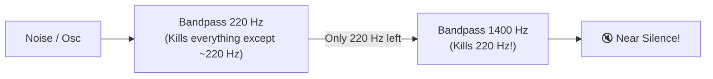
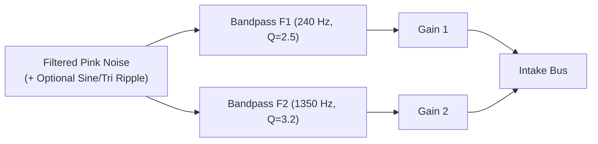

# Chapter 1 (Tier 1): Subtractive DSP, Formant Filtering & Drivetrain Dynamics

## Learning Goals
By the end of this chapter, you will understand from first principles:

1. Why digital oscillators sound "buzzy" or "warbly," how **harmonics**, **octaves**, and **decibels** work, and how **waveform-by-order stratification** and **crankshaft phase-locking** establish a realistic engine-order hierarchy.
2. What a digital **Biquad Filter** is—how cutoff frequency ($f_c$), Web Audio's decibel vs. dimensionless **$Q$ conventions**, and **cascaded 4th-order ($-24\text{ dB/oct}$) Butterworth low-pass rounding** sculpt organic time-domain pressure waves.
3. **Formants, Exhaust Thermodynamics & Cam Curves:** How the **Source–Filter Model** works, why exhaust gas temperature ($c = \sqrt{\gamma R T}$) causes controlled formant drift, why **wide-$Q$ body domes** beat narrow synth spikes, and how **nonlinear cam-crossover modulation ($u_{\text{RPM}}^\gamma$)** unlocks top-end metallic "zing" ($2.0\text{–}4.5\text{ kHz}$) without midrange buzz.
4. **Pre-Waveshaper Turbulence Coupling & Drivetrain Dynamics:** How feeding stochastic gas noise *into* a waveshaper creates pitch-locked $\text{sech}^2$ intermodulation, how short inverting comb delays model exhaust pipes in Tier 1, and why half of parking realism lives in the **Drivetrain & Load model**.

---

## 1.1 DSP From Zero: Waves, Harmonics, and Why Your Current Synth Buzzes

### What Sound Actually Is in Code
Sound in air is tiny, rapid fluctuations in atmospheric pressure pushing on your eardrum. Your browser's Web Audio API represents this pressure wave digitally as a stream of floating-point numbers $x[n] \in [-1.0, +1.0]$, typically sampled **$f_s = 48{,}000$ times per second** ($48\text{ kHz}$).

Every periodic sound can be viewed in two complementary ways:

* **Time Domain ($x[n]$ vs. time):** The shape of the pressure wiggle from millisecond to millisecond (what an oscilloscope draws).
* **Frequency Domain (Amplitude vs. Hz):** The recipe of pure sine waves that add together to make that shape (what the FFT bar graph in [`src/audio_tuner.html`](../src/audio_tuner.html) draws).

Before touching filters, keep two perceptual rules of human hearing in mind—both are **logarithmic**, not linear:

1. **Pitch is perceived in Octaves ($2\times$ frequency):** Going from $50\text{ Hz} \to 100\text{ Hz}$ sounds like the *exact same* musical interval (one octave) as going from $1{,}000\text{ Hz} \to 2{,}000\text{ Hz}$.
2. **Loudness is measured in Decibels ($\text{dB}$):**
   $$\text{dB} = 20 \log_{10}\left(\frac{A_2}{A_1}\right)$$

    - **$+6\text{ dB}$** $\approx 2\times$ the wave amplitude.
    - **$-6\text{ dB}$** $\approx 0.5\times$ the wave amplitude.
    - **$-20\text{ dB}$** $= 0.1\times$ the wave amplitude ($10%$ left).
    - **$-40\text{ dB}$** $= 0.01\times$ the wave amplitude ($1%$ left—nearly inaudible in a mix).

---

### Fourier's Theorem & The Harmonic Series
In 1822, Joseph Fourier proved a remarkable fact: **any** repeating waveform with fundamental frequency $f_0$ (say, $50\text{ Hz}$) is mathematically identical to a sum of pure sine waves at integer multiples of $f_0$:
$$1f_0,\; 2f_0,\; 3f_0,\; 4f_0,\; 5f_0 \dots$$

These multiples are called **harmonics** (or **overtones**). What distinguishes a flute from a brass horn or a buzzing chainsaw playing the exact same $50\text{ Hz}$ pitch is *solely* the relative loudness of those harmonics:

| Web Audio Waveform | Which Harmonics Exist? | Natural High-End Roll-Off | What It Sounds Like Raw |
| :--- | :--- | :--- | :--- |
| **`sine`** | Only $1f_0$ (no overtones) | Infinite (nothing above $f_0$) | Pure tuning fork, hum, sub-bass |
| **`triangle`** | Odd only ($1f_0, 3f_0, 5f_0 \dots$) | Fast: amplitude $\propto \frac{1}{n^2}$ (**$-12\text{ dB/oct}$**) | Mellow, hollow, muted flute |
| **`square`** | Odd only ($1f_0, 3f_0, 5f_0 \dots$) | Slow: amplitude $\propto \frac{1}{n}$ (**$-6\text{ dB/oct}$**) | Clarinet, 8-bit Nintendo |
| **`sawtooth`** | **All** ($1f_0, 2f_0, 3f_0, 4f_0 \dots$) | Slow: amplitude $\propto \frac{1}{n}$ (**$-6\text{ dB/oct}$**) | Bright, raspy, buzzy synthesizer |

### Autopsy of Your Current `AudioController.js`
Open [`src/AudioController.js`](../src/AudioController.js) and look at lines 296–326 and 180–221:

1. For an Inline-6 (`i6`), `setupEngineSound()` spawns **five `sawtooth` oscillators** simultaneously (`1.0x`, `1.5x`, `3.0x`, `4.5x`, `6.0x`). Because *each* sawtooth already contains every integer harmonic ($1, 2, 3 \dots \infty$) rolling off at a gentle $-6\text{ dB/oct}$, stacking five of them floods the spectrum from $20\text{ Hz}$ all the way up to $20{,}000\text{ Hz}$ with phase-locked digital teeth.
2. Next, all five sawtooths feed directly into a nonlinear **`WaveShaperNode` (distortion)**. Waveshaping clips the peaks of the sum, generating *even more* high-frequency harmonics and intermodulation products.
3. Finally, look at what sits between that distortion node and your speakers: **two narrow `notch` filters** at $1{,}000\text{ Hz}$ and $2{,}500\text{ Hz}$, and **zero low-pass filter**. Every harsh harmonic at $3\text{ kHz}, 5\text{ kHz}, 8\text{ kHz}$ hits your ears completely unattenuated!

### Engine Orders vs. Arbitrary `baseFreq`
In automotive acoustics, engineers don't guess a magic `baseFreq: 17` or `baseFreq: 22`—every frequency comes directly from crankshaft geometry:

* **Crankshaft Rotational Frequency ($1\text{st Engine Order}$, or $1\text{E}$):**
  $$f_{\text{rot}} = \frac{\text{RPM}}{60}\;\text{Hz}$$

* **Single-Cylinder Firing Frequency ($0.5\text{E}$, the "Half-Order"):** In a 4-stroke engine (Intake $\to$ Compression $\to$ Power $\to$ Exhaust), each cylinder fires once every **two** crank revolutions:
  $$f_{\text{cyl}} = 0.5 \cdot f_{\text{rot}} = \frac{\text{RPM}}{120}\;\text{Hz}$$

* **Total Engine Firing Frequency ($\frac{N_{\text{cyl}}}{2}\text{E}$):** Across $N_{\text{cyl}}$ cylinders firing evenly over two revolutions:
  $$f_{\text{fire}} = \frac{N_{\text{cyl}}}{2} \cdot f_{\text{rot}} = \frac{\text{RPM} \cdot N_{\text{cyl}}}{120}\;\text{Hz}$$

---

> ### 🤔 Pause & Think 1.1: Physical Engine Orders
>
> 1. Calculate $f_{\text{rot}}$ ($1\text{E}$) and $f_{\text{fire}}$ in Hz for:
>     - An **Inline-4** at $900\text{ RPM}$ idle vs. $6{,}500\text{ RPM}$ redline.
>     - Your **987.2 Cayman S Flat-6** at $950\text{ RPM}$ idle vs. $7{,}400\text{ RPM}$ redline.
>
> 2. Look at `ENGINE_PRESETS.flat6.harmonics` in [`AudioController.js`](../src/AudioController.js): it lists multipliers `[3.0, 1.5, 1.0, 6.0, 0.75]` relative to `baseFreq: 17`. If `baseFreq` represents $f_{\text{rot}}$ at idle ($950 / 60 = 15.83\text{ Hz}$), what physical part of a 6-cylinder boxer engine produces **`3.0x`** vs. **`1.5x`**? *(Hint: think about how the exhaust manifolds on a Flat-6 are arranged!)*

<details>
<summary>💡 Check Your Thinking</summary>

1. **Frequencies:**
    - **Inline-4 ($N_{\text{cyl}} = 4 \implies f_{\text{fire}} = 2 f_{\text{rot}}$):**
        - At $900\text{ RPM}$: $f_{\text{rot}} = 15.0\text{ Hz}$, and $f_{\text{fire}} = 30.0\text{ Hz}$ (right at the bottom of human bass hearing!).
        - At $6{,}500\text{ RPM}$: $f_{\text{rot}} = 108.3\text{ Hz}$, and $f_{\text{fire}} = 216.7\text{ Hz}$.
    - **Flat-6 ($N_{\text{cyl}} = 6 \implies f_{\text{fire}} = 3 f_{\text{rot}}$):**
        - At $950\text{ RPM}$: $f_{\text{rot}} = 15.83\text{ Hz}$, and $f_{\text{fire}} = 47.5\text{ Hz}$.
        - At $7{,}400\text{ RPM}$: $f_{\text{rot}} = 123.3\text{ Hz}$, and $f_{\text{fire}} = 370.0\text{ Hz}$ (roughly F#4 above middle C!).

2. **Physical meaning of `3.0x` vs. `1.5x` on a Flat-6:**
    - **`3.0x` ($3\text{E}$)** is the **combined 6-cylinder firing frequency** (all 6 cylinders merging at the X-pipe/tailpipes: $6 / 2 = 3$ firings per revolution).
    - **`1.5x` ($1.5\text{E}$)** is the **single-bank firing frequency**! A Flat-6 has 3 cylinders on the Left bank and 3 on the Right bank, each feeding its own 3-into-1 exhaust manifold ($3 / 2 = 1.5$ firings per crank revolution per bank). That `1.5E` + `3.0E` interplay is why 6-cylinder engines with split 3-cylinder manifolds have a throatier, deeper undertone than a single-manifold engine! (Meanwhile `0.75x` doesn't exist physically on a 4-stroke—the lowest possible combustion order is `0.5x`, a single cylinder firing once per 2 revolutions.)

</details>

---

### Stratified Waveforms, Order Hierarchy & Crankshaft Phase-Locking

Knowing *which* engine orders exist ($1.0\text{E}, 1.5\text{E}, 3.0\text{E} \dots$) is only half the source problem. When you actually rev an engine across a $5\times\text{–}8\times$ RPM span, three physical rules govern whether those oscillators sound like a real cast-metal powertrain or a buzzy, warbling synthesizer:

#### 1. Mid-RPM "Spectral Evacuation" vs. High-RPM Sub-Order Dominance
When an engine sweeps from $900\text{ RPM}$ ($f_{\text{rot}} = 15\text{ Hz}$) up to $4{,}500\text{ RPM}$ ($f_{\text{rot}} = 75\text{ Hz}$), **every harmonic oscillator shifts upward by $5\times$ (more than two octaves)**.

* **If you omit `1.0x` and `1.5x`:** On a Flat-6, `3.0x` climbs to $225\text{ Hz}$ at $4{,}500\text{ RPM}$, leaving the entire **$50\text{–}150\text{ Hz}$ chest register completely empty** ("spectral evacuation"). Psychoacoustically, the moment low-mid chest energy disappears while $1\text{–}3\text{ kHz}$ overtones remain, your brain stops hearing a heavy aluminum engine block and hears a thin synth lead.
* **If `1.0x` and `1.5x` stay too loud at redline:** Conversely, on an inherently balanced, even-firing engine (such as a horizontally opposed Flat-6 or a $72^\circ$ Formula 1 V10), primary reciprocating forces cancel. At $7{,}400\text{ RPM}$, the **merged primary firing order (`3.0x` = $370\text{ Hz}$ on a Flat-6; `5.0x` = $1{,}583\text{ Hz}$ on a $19{,}000\text{ RPM}$ V10)** must dominate the spectrum by **$+5\text{ to }+15\text{ dB}$** over `1.0x`! If `1.0x` and `1.5x` grow linearly to high gain at redline, they boom unnaturally *and* consume the headroom of your downstream nonlinear waveshaper—**ducking and compressing the high-frequency "zing"** every time the low bass wave peaks!
* **Rule of thumb:** Anchor the chest floor with moderate `1.0x` and single-bank (`1.5x` on 6-cyl, `2.5x` on V10) orders at low/mid RPM, then give `1.0x` (and `1.5x` on even-fire engines) a **flat or slightly negative RPM gain slope** (`rpmModGain <= 0`) so they step gracefully out of the way as the primary firing order (`3.0x` / `5.0x`) and upper overtones (`6.0x`, `9.0x`) take command! *(Exception: odd-firing engines with divorced bank pipes—such as an $8.4\text{L}$ $90^\circ$ V10 with $54^\circ / 90^\circ$ split crankpins and side-exit exhausts—physically retain massive `1.0x`, `1.5x`, and `2.5x` 5-cylinder bank energy all the way to redline.)*

#### 2. Waveform-by-Order Stratification ($1/n^2$ vs. $1/n$)
Never assign `sawtooth` blindly to every engine order! Stratify waveforms by their physical acoustic job:

| Order Tier | Example Orders | Best Waveform | Physical & Spectral Reason |
| :--- | :--- | :--- | :--- |
| **Sub & Bank Undertones** | `1.0x` (crank/block), `1.5x` (3-cyl bank), `2.5x` (5-cyl bank) | **`triangle`** ($-12\text{ dB/oct}$) | Odd harmonics decay fast as $1/n^2$, injecting pure $50\text{–}250\text{ Hz}$ chest weight without polluting $2\text{–}6\text{ kHz}$ with extra sawtooth buzz. |
| **Primary Firing Core** | `2.0x` (I4), `3.0x` (I6/Flat-6), `4.0x` (V8), `5.0x` (V10) | **`sawtooth`** ($-6\text{ dB/oct}$) | Contains **all** integer harmonics ($1/n$) to excite mid and upper exhaust formants as RPM climbs. |
| **Smooth Chordal Color** | `4.5x` (Flat-6 3rd bank), `7.5x` (V10 3rd bank / musical 5th) | **`triangle`** or **`sine`** | Reinforces characteristic bank intervals without harsh intermodulation clutter. |
| **Top-End Metallic Zing** | `6.0x`, `9.0x` (Flat-6/I6), `10.0x` (F1 V10) | **`sawtooth`** *(gated by $u_{\text{RPM}}^\gamma$)* | Stays nearly silent below $4{,}500\text{ RPM}$, then surges near redline to project crisp $1.5\text{–}4.5\text{ kHz}$ mechanical bite! |

#### 3. Crankshaft Phase-Locking (`0 cents` Detune) vs. The Chorus Warble Trap
In music synthesizers, sound designers often detune oscillators by $\pm 4\text{ to }10\text{ cents}$ ("supersaw") to make pads sound wide. **Never detune harmonic orders of a single engine!**

Physically, every piston and exhaust valve in an engine is geared to **one rigid steel crankshaft**—the left cylinder bank cannot spin at $6{,}500\text{ RPM}$ while the right bank spins at $6{,}515\text{ RPM}$! If you detune `1.5x` by `-4 cents` and `4.5x` by `+5 cents` before a nonlinear waveshaper, their harmonics drift in and out of phase $2\text{–}4$ times per second, producing an **`18%` slow amplitude "wah-wah" warble** (like a guitar chorus pedal or an uneven twin-engine prop plane). Keep all crankshaft orders **100% phase-locked (`detune = 0`)**; real cycle-to-cycle mechanical life comes from stochastic gas turbulence inside the waveshaper (Section 1.4), not detuned pitch beating!

---

## 1.2 Digital Filters & The Suspension Analogy ($f_c$, Slope, and $Q$)

Subtractive synthesis works just like sculpting marble: you start with a harmonically rich raw wave (lots of overtones) and **carve away** the frequencies a physical muffler, intake box, and engine block wouldn't let out.

In Web Audio, `ctx.createBiquadFilter()` gives you a **2nd-order digital filter** ("biquad" because its transfer function is a ratio of two quadratic polynomials—under the hood, it computes each output sample using just 5 multiplications on the current/last 2 input samples and last 2 output samples).

### The Suspension Analogy: What $f_c$ and $Q$ Actually Mean
If you understand how coilover springs and dampers behave on a car, you already understand a 2nd-order `lowpass` filter—**they obey the exact same 2nd-order differential equation!**

Imagine driving over bumps of frequency $f$, where road height is the input wave and car body motion is the output wave:

1. **Cutoff Frequency ($f_c$, `filter.frequency.value` in Hz):** This is the **natural frequency** of the spring-mass system ($\omega_n = \sqrt{k/m}$).
    - Slow highway undulations ($f \ll f_c$): The chassis follows the road $1:1$ (**Passband**, $0\text{ dB}$).
    - Fast cobblestone chatter ($f \gg f_c$): The tire vibrates, but the heavy chassis doesn't have time to move. Above $f_c$, a single 2nd-order `lowpass` filter attenuates energy at **$-12\text{ dB per octave}$** (every time frequency doubles, amplitude drops by $4\times$!).

2. **Quality Factor ($Q$, `filter.Q.value`) & Web Audio's Crucial Unit Law:**
   In textbook physics (Robert Bristow-Johnson's Audio EQ Cookbook), dimensionless quality factor $Q = \frac{1}{2\zeta}$ governs resonance: **$Q = \frac{1}{\sqrt{2}} \approx 0.707$** is **Butterworth critical damping** (maximally flat passband with zero overshoot).
   However, **Web Audio's `BiquadFilterNode` uses two different units for `Q` depending on `filter.type`**:
    - For **`peaking`**, **`bandpass`**, and **`notch`**, `filter.Q.value` is **dimensionless $Q$** directly (`0.707` = wide, `4.0` = narrow).
    - For **`lowpass`** and **`highpass`**, Web Audio defines `filter.Q.value` **in decibels**! To convert dimensionless textbook $Q$ into Web Audio's `lowpass`/`highpass` parameter, always apply:
      $$Q_{\text{WebAudio (dB)}} = 20 \log_{10}(Q_{\text{dimensionless}})$$
      Thus, true maximally flat **Butterworth damping ($Q = 0.707$)** requires setting `filter.Q.value = -3.01` dB (`Q = 1.0` maps to `0.0 dB`, and `Q = 2.0` maps to `+6.02 dB` of resonant peaking)!

```
Gain (dB)
 +12 |             /\  <-- High Q (Underdamped: rings/whistles at fc!)
     |            /  \
   0 |-----------/----\---------  <-- Butterworth Q=0.707 (-3.01 dB in Web Audio)
     |                 \
 -12 |                  \   1x Lowpass = -12 dB / octave
     |                   \  2x Cascaded Butterworth = -24 dB / octave!
 -24 |                    \
     +-----------------------------------------> Frequency (log scale)
                fc    2*fc  4*fc
```

### Why Cascading Two Butterworth Low-Pass Filters (`-24 dB/oct`) Rounds the Waveform
Why does a single 2nd-order `lowpass` filter still sound slightly "synthy" in the midrange ($3{,}000\text{–}5{,}000\text{ RPM}$) once $f_c$ opens up to $700\text{–}1{,}200\text{ Hz}$?

By Fourier's theorem, "buzziness" in the frequency domain is mathematically identical to **sharp vertical step discontinuities** (high sample-to-sample slew $|dx/dt|$) in the time domain:

* A raw `sawtooth` decays slowly at **$-6\text{ dB/oct}$**. Passing it through **one** 2nd-order low-pass ($-12\text{ dB/oct}$) yields $-18\text{ dB/oct}$—gentle enough that $2.5\text{–}6\text{ kHz}$ sawtooth teeth remain audible whenever $f_c$ opens under throttle.
* Wiring **two critically damped Butterworth low-pass filters in series (`lp1 -> lp2`, $Q \approx 0.707\text{–}0.75$)** doubles the slope to **$-24\text{ dB/octave}$** ($-30\text{ dB/oct}$ total roll-off on a sawtooth!) with **zero resonant bump** at $f_c$. In the time domain, this 4th-order cascade acts as a physical spline smoother that rounds every sharp sawtooth corner into a continuous, organic exhaust pressure pulse!

### Your Four Workhorse `BiquadFilterNode` Types

| `filter.type` | What It Does | Parameters You Set | Acoustic Role in an Engine |
| :--- | :--- | :--- | :--- |
| **`lowpass`** | Passes $< f_c$, cuts $> f_c$ at $-12\text{ dB/oct}$ (`-24 dB/oct` in pairs!) | `frequency` ($f_c$), `Q` ($20\log_{10} Q_{\text{RBJ}}$) | **Muffler absorption & waveform rounding** (tight at idle/mid, opens at high RPM/load) |
| **`highpass`** | Cuts $< f_c$, passes $> f_c$ at $-12\text{ dB/oct}$ | `frequency` ($f_c$), `Q` ($20\log_{10} Q_{\text{RBJ}}$) | **Speaker protection / removing sub-25 Hz DC offset** |
| **`bandpass`** | Passes around $f_c$; cuts below & above at **only $-6\text{ dB/oct}$**! | `frequency` ($f_c$), `Q` ($= f_c / \Delta f$) | **Noise-only induction cavities** *(caution: leaks HF buzz if fed raw oscillators!)* |
| **`peaking`** | Leaves flat $0\text{ dB}$ passband, boosts/cuts a bell around $f_c$ | `frequency` ($f_c$), `Q` ($= f_c / \Delta f$), **`gain`** (dB) | **Series Formant body domes & top-end metallic zing** |

---

> ### 🤔 Pause & Think 1.2: Taming the Exhaust Buzz
>
> At $900\text{ RPM}$ idle, your exhaust `WaveShaper` generates nasty high-frequency buzz around **$2{,}400\text{ Hz}$**. Suppose you insert a single `lowpass` `BiquadFilterNode` after the `WaveShaper` with cutoff **$f_c = 300\text{ Hz}$** (Butterworth flat resonance).
>
> 1. How many **octaves** above $300\text{ Hz}$ is $2{,}400\text{ Hz}$?
> 2. Using the $-12\text{ dB/octave}$ slope of a 2nd-order low-pass filter, by how many **decibels** is that $2{,}400\text{ Hz}$ buzz reduced, and roughly what **percentage** of its original amplitude survives?
> 3. What happens to the attenuation at $2{,}400\text{ Hz}$—and to the oscilloscope waveform—when you cascade **two** Butterworth `lowpass` nodes in series (`ws -> lp1 -> lp2`)?

<details>
<summary>💡 Check Your Thinking</summary>

1. **Octaves:** $300 \xrightarrow{\times 2} 600 \xrightarrow{\times 2} 1{,}200 \xrightarrow{\times 2} 2{,}400\text{ Hz}$ ($\frac{2400}{300} = 8 = 2^3$). That is **3 octaves**.
2. **Attenuation:** $3\text{ octaves} \times (-12\text{ dB/oct}) = \mathbf{-36\text{ dB}}$.
   In linear amplitude: $10^{-36 / 20} \approx 0.0158$ (or $\frac{1}{8^2} = \frac{1}{64}$)—only **~1.6%** of the harsh $2{,}400\text{ Hz}$ buzz survives, while the fundamental $30\text{–}150\text{ Hz}$ engine note below $300\text{ Hz}$ passes through at **100%** ($0\text{ dB}$)!
3. **Cascading two `lowpass` nodes:** Decibels **add** in series! Two 2nd-order Butterworth stages create a 4th-order ($-24\text{ dB/oct}$) filter, crushing $2{,}400\text{ Hz}$ by **$-72\text{ dB}$** ($0.025\%$ amplitude—dead silent) and rounding sharp time-domain sawtooth corners into smooth pressure crests.

</details>

---

## 1.3 What Is a Formant Filter? (The Source–Filter Model)

This brings us to your core question: **What actually *is* a formant filter, and why is it the secret to realistic acoustic synthesis?**

### The Human Voice Experiment
Sing the vowel **"Ahhh"** at a low note, and then slide your pitch smoothly up an octave while still holding **"Ahhh"**. Now repeat the exact same low-to-high pitch slide while singing **"Eeee"**.

Notice two things happened simultaneously:

1. **The Source (Your Vocal Cords)** slid *up* in frequency ($f_0, 2f_0, 3f_0 \dots$ all doubled).
2. **The Filter (Your Throat & Mouth Cavity)** did **NOT** shrink to half its physical size when you sang higher! Because the physical volume and length of your vocal tract stayed constant, its acoustic resonant peaks—called **Formants** ($F_1 \approx 730\text{ Hz}, F_2 \approx 1{,}090\text{ Hz}$ for *"Ahhh"*; $F_1 \approx 270\text{ Hz}, F_2 \approx 2{,}290\text{ Hz}$ for *"Eeee"*)—**stayed fixed in Hz!**

> **Definition:** A **Formant** is a **stationary** (or geometry-dependent, *not* pitch-dependent) resonant peak of a physical acoustic cavity.

### Why Moving Filters Sound Like Cartoon Synths
Look at line 374 of your current [`AudioController.js`](../src/AudioController.js):
```js
intakeFreq: p.intake.filterBase + (absSpeed * p.intake.filterRange)
```
Right now, as `absSpeed` goes from `0` to `1`, your intake bandpass filter slides from `400 Hz` up to `2900 Hz` *in lockstep with RPM*. Physically, that simulates an intake airbox that magically shrinks from the size of a shoebox at idle down to the size of a thimble at redline! When *both* harmonics and filter peaks move together, your ear hears a synthetic "wah-wah" pitch-shift rather than a real metal machine.

In a real car, the **engine block, intake plenum, intake runners, header collectors, and muffler chambers have fixed physical dimensions**:

1. **Helmholtz Resonances ($100\text{–}350\text{ Hz}$):** Just like blowing across the neck of an empty glass bottle, air mass in an intake snorkel bouncing against the springiness of air inside the airbox (or a muffler expansion chamber) rings at a fixed low-mid frequency:
   $$f_H = \frac{c}{2\pi}\sqrt{\frac{A_{\text{neck}}}{V_{\text{cavity}} \cdot L_{\text{neck}}}}$$

2. **Pipe Standing-Wave Modes ($400\text{–}2{,}500\text{ Hz}$):** Intake runners ($30\text{–}50\text{ cm}$) and exhaust mid-pipes ($1.5\text{–}3\text{ m}$) reinforce fixed wavelengths ($f = \frac{c}{4L}$ or $\frac{c}{2L}$).
3. **What creates the "Spine-Tingling Sweep":** As RPM climbs, the engine's harmonics ($1\times, 2\times, 3\times, 4\times f_{\text{fire}}$) **march upward through those fixed formant peaks one after another**. Each time a strong engine harmonic crosses a stationary cavity formant, that harmonic suddenly swells and sings before passing through and handing off to the next harmonic below it!

*(Note: The one mechanical exception where an intake formant *jumps* between two fixed frequencies is a physical **variable intake resonance flap**—like Porsche's dual-stage resonance intake manifold on the 987.2 S or BMW's DISA valve—which snaps open a connecting plenum valve around $4{,}200\text{–}5{,}500\text{ RPM}$, shifting the Helmholtz peak between two discrete physical states!)*

### Exhaust Thermodynamics: Why Exhaust Formants Drift Gently ($20\text{–}45\%$) With Load & RPM
Look closely at the Helmholtz and standing-wave equations above ($f_H \propto c$ and $f_{\text{pipe}} = \frac{c}{4L}$): both depend linearly on the **local speed of sound $c$** inside the gas! In an ideal gas, the speed of sound is governed by absolute temperature $T$ (in Kelvin):
$$c = \sqrt{\gamma R_{\text{specific}} T}$$

* **Intake Tract (Cold Ambient Air, Stationary Formants):** Fresh air entering the airbox and intake runners stays near ambient temperature ($T \approx 295\text{–}315\text{ K}$, so $c \approx 345\text{–}355\text{ m/s}$ regardless of RPM). Intake cavity formants are therefore genuinely stationary in Hz.
* **Exhaust System (Hot Combustion Gas, Controlled Thermal Drift):** Exhaust gas leaves the ports at $\sim 570\text{ K}$ ($300^\circ\text{C}$) at idle/light cruise ($c \approx 480\text{ m/s}$), but climbs to $\sim 1{,}100\text{–}1{,}200\text{ K}$ ($830\text{–}930^\circ\text{C}$) under sustained high-RPM wide-open throttle ($c \approx 670\text{–}700\text{ m/s}$)! Because $\sqrt{1150 / 570} \approx 1.42$, **physical exhaust formants naturally drift upward in frequency by $20\text{–}45\%$ with RPM and throttle load** (for instance, a $275\text{ Hz}$ warm chest resonance rising gently toward $\sim 365\text{ Hz}$ at WOT redline)—far smaller than a $500\%$ cartoon synth sweep, yet crucial for conveying rising exhaust heat and gas velocity!

### Wide-$Q$ "Body Domes" vs. Narrow Synth Spikes & The Mid-Scoop Trap
For a 2nd-order `peaking` filter, its $-3\text{ dB}$ frequency bandwidth $\Delta f$ and its time-domain impulse ringing decay constant $\tau$ are coupled directly through $Q$:
$$\Delta f = \frac{f_c}{Q}, \qquad \tau \approx \frac{Q}{\pi f_c}$$

Two classic EQ mistakes immediately make a procedural engine sound thin or synthetic between $3{,}000\text{ and }6{,}000\text{ RPM}$:

1. **Narrow High-$Q$ Peaks ($Q > 4.0$):** A narrow peak has a long ringing tail $\tau$. Whenever an engine harmonic sweeps across a `+10 dB, Q = 5` spike in the sensitive $1\text{–}2\text{ kHz}$ region, it whistles like a resonant flute or acid-house synth filter.
2. **Over-Scooping the Lower Midrange (`250–400 Hz`):** Studio engineers sometimes cut $300\text{–}350\text{ Hz}$ on guitar tracks to reduce "boxiness." On a 6-cylinder engine, however, `3.0x` ($f_{\text{fire}}$) spends the *entire* $3{,}000\text{–}6{,}000\text{ RPM}$ midrange walking straight through $150\text{–}300\text{ Hz}$ while `4.5x` traverses $225\text{–}450\text{ Hz}$! Placing a `-4.5 dB` notch at $330\text{ Hz}$ hollows out the engine's primary firing note right where it needs mechanical chest weight.

**The Wide-$Q$ Body Dome Solution:** Place two broad, low-$Q$ (`Q = 1.2–1.6`) positive `peaking` filters at adjacent low-mid frequencies—e.g., **$F_1 \approx 140\text{–}150\text{ Hz}$ (`+6 dB, Q = 1.3`)** and **$F_2 \approx 265\text{–}285\text{ Hz}$ (`+5 dB, Q = 1.4`)**. Because their wide bell curves ($\Delta f \approx 110\text{–}200\text{ Hz}$) overlap smoothly with almost zero time-domain ringing, they fuse into a continuous **$+5\text{ to }+6.5\text{ dB}$ acoustic body plateau spanning $80\text{–}450\text{ Hz}$**—giving cast-iron V8s, side-pipe V10s, and aluminum Flat-6 blocks unmistakable physical thickness across the entire rev range.

### Nonlinear Cam-Crossover Curves ($u_{\text{RPM}}^\gamma$) & Top-End Metallic "Zing"
Suppose you modulate your dual `-24 dB/oct` exhaust low-pass cutoff **linearly** with normalized RPM $u_{\text{RPM}} \in [0, 1]$:
$$u_{\text{RPM}} = \frac{\text{RPM} - \text{RPM}_{\text{idle}}}{\text{RPM}_{\text{redline}} - \text{RPM}_{\text{idle}}}$$

You immediately hit a frustrating wall:

* If you set the redline cutoff high enough ($3{,}500\text{–}4{,}300\text{ Hz}$) to let out the exhilarating $2.0\text{–}4.5\text{ kHz}$ **metallic "zing" and raspy scream** at $7{,}400\text{ RPM}$, linear scaling forces the cutoff wide open to **$\sim 1{,}750\text{ Hz}$ already at $3{,}500\text{ RPM}$**—making cruising midrange buzzy and thin!
* Conversely, if you clamp redline cutoff down to $1{,}800\text{ Hz}$ to protect midrange warmth, the top end ($6{,}000\text{–}7{,}400\text{ RPM}$) sounds dark and suffocated!

How does a real naturally aspirated sports engine (Porsche VarioCam Plus, Honda VTEC, BMW Double-VANOS) stay warm and rounded at $3{,}500\text{ RPM}$ yet erupt into a metallic scream above $5{,}500\text{ RPM}$? **Nonlinear valvetrain breathing!** Below $4{,}500\text{ RPM}$, the engine breathes through mild, short-duration cam lobes; in the upper third of the tach, high-lift cam profiles and resonance flaps open, dramatically accelerating exhaust blowdown slew rate ($dp/dt$).

In DSP, we model this cleanly by raising $u_{\text{RPM}}$ to a **convex power-law exponent $\gamma > 1$** ($\gamma \approx 2.2\text{–}2.8$):
$$p(u_{\text{RPM}}, u_{\text{load}}) = p_{\text{base}} + \Delta p_{\text{RPM}} \cdot u_{\text{RPM}}^{\gamma} + \Delta p_{\text{load}} \cdot u_{\text{load}}$$

Check the numbers at **$3{,}500\text{ RPM}$** ($u_{\text{RPM}} = 0.40$ on a $900\text{–}7{,}400\text{ RPM}$ Flat-6) with $\gamma = 2.8$:

* $u_{\text{RPM}}^{2.8} = 0.40^{2.8} = \mathbf{0.077}$ (**less than $8\%$** of the RPM modulation has engaged!). Even with a huge $+2{,}650\text{ Hz}$ high-RPM cutoff span, $f_{\text{LP}}$ stays tucked around **$\sim 700\text{ Hz}$** at $3{,}500\text{ RPM}$—100% warm, rounded, and buzz-free.
* Above **$5{,}800\text{ RPM}$** ($u_{\text{RPM}} = 0.75 \to 1.00$), $u_{\text{RPM}}^{2.8}$ accelerates steeply from $0.45 \to 1.00$, sweeping the dual low-pass out to **$3{,}300\text{–}4{,}350\text{ Hz}$** right as upper sawtooth zing harmonics (`6.0x` with $\gamma = 2.2$, `9.0x` with $\gamma = 2.6$) and a dedicated **High Metallic Zing Formant ($1{,}650 \to 2{,}650\text{ Hz}$, `+6.5 dB, Q = 2.2`)** blossom into a spine-tingling mechanical scream!

---

## 1.4 Engineering Your Complete Tier 1 Signal Chain

### Crucial Trap: Series vs. Parallel Bandpass Routing!
Suppose you want two intake formant peaks—one throaty airbox boom at **$220\text{ Hz}$** and one intake runner howl at **$1{,}400\text{ Hz}$**—and you wire two `bandpass` filters in **series**:



**Never chain narrow `bandpass` filters in series!** The first bandpass strips away the frequencies the second bandpass needs. Instead, pair two distinct topologies for Intake vs. Exhaust:

#### Topology A: Parallel `bandpass` Bank (For Turbulent Intake Induction)
Split turbulent induction noise (`pink` noise modulated by throttle load and $u_{\text{RPM}}^{1.5}$) into parallel `bandpass` branches (`frequency` = $F_k$, `Q` = sharpness), then sum them into the Intake Bus:



* **Critical `-6 dB/oct` Leak Warning:** Remember from Section 1.2 that a 2nd-order `bandpass` filter rolls off above $f_c$ at **only $-6\text{ dB/octave}$**! If you route a raw `sawtooth` oscillator ("firing ripple") into an intake `bandpass` filter that connects directly to `master` (bypassing your `-24 dB/oct` exhaust low-pass), its $2\text{–}6\text{ kHz}$ sawtooth teeth will short-circuit straight to your speakers as midrange buzz! Feed **only** turbulent `pink` noise (or strictly band-limited `sine`/`triangle` fundamentals) into parallel intake bandpasses.

#### Topology B: Nonlinear Turbulent Coupling + Pipe Comb + Series `peaking` Formants + Dual `-24 dB/oct` Low-Pass (For Exhaust)
Unlike `bandpass`, **`peaking`** filters pass the full spectrum at $0\text{ dB}$ and sculpt broad body domes or upper metallic formants in series. Combining four physical stages in series produces an astonishingly lifelike Tier 1 exhaust chain:


Look at why each stage in Topology B is physically indispensable:

1. **Pre-Waveshaper Stochastic Intermodulation ($\text{sech}^2$ Turbulence Coupling):**
   Pure oscillators are 100% periodic ($s(t+T) = s(t)$), whereas real cylinders exhibit cycle-to-cycle combustion variations and high-velocity port shear. If you layer noise *after* your filters, your ear hears static radio hiss sitting *on top* of a clean synth. Instead, sum low-frequency **`brown` noise** ($1/f^2$ collector chuff) plus high-RPM **`pink` noise** ($1/f$ header gas rush, gated by $u_{\text{RPM}}^{1.8}$) $n(t)$ **directly into the `Math.tanh` waveshaper** alongside your periodic engine wave $s(t)$. A first-order Taylor expansion reveals the magic:
   $$y(t) = \tanh\Big(k \cdot \big(s(t) + n(t)\big)\Big) \approx \underbrace{\tanh\big(k \cdot s(t)\big)}_{\text{Saturated Engine Wave}} + \underbrace{k \cdot \text{sech}^2\big(k \cdot s(t)\big) \cdot n(t)}_{\text{Pitch-Synchronized Turbulent Bursts}}$$
   Because $\text{sech}^2(x) = 1 - \tanh^2(x)$ peaks at every waveform zero-crossing and compresses near wave crests, **the nonlinearity automatically amplitude-modulates the gas noise in lockstep with each cylinder firing pulse!** *(Headroom corollary: this same $\text{sech}^2$ term also explains why overly loud `1.0x` bass waves compress and duck $2\text{–}4.5\text{ kHz}$ zing harmonics inside the waveshaper—keep `1.0x` balanced at high RPM!)*

2. **Short Inverting Comb-Delay Pipe Waveguide ($0.9\text{–}3.4\text{ ms}$):**
   Even before building a 48 kHz `AudioWorklet` waveguide in Chapter 2, inserting a short Web Audio `DelayNode` ($\tau_d$) with **negative feedback** (`feedback ≈ -0.26 to -0.35`, modeling the phase-inverting open-pipe pressure reflection) and `25–35%` wet mix right after the waveshaper reinforces odd pipe harmonics around $f_1 = \frac{1}{2\tau_d}$ and adds natural phase dispersion:

    - **$\tau_d \approx 0.9\text{ ms}$ ($f_1 \approx 555\text{ Hz}$):** Short, stubby $3.0\text{L}$ Formula 1 Inconel megaphone collector.
    - **$\tau_d \approx 2.2\text{ ms}$ ($f_1 \approx 227\text{ Hz}$):** Mid-engine Flat-6 header-to-muffler collector path.
    - **$\tau_d \approx 3.4\text{ ms}$ ($f_1 \approx 147\text{ Hz}$):** Long sill-mounted side-exit pipe on an $8.4\text{L}$ V10.

3. **Series `peaking` Formant Bank (4 Zones) + Dual `-24 dB/oct` Butterworth Low-Pass:**
   Four series `peaking` biquads take $< 0.1\%$ CPU and map 1-to-1 onto physical acoustic regions:

    - **$F_1$ ($100\text{–}160\text{ Hz}$, $Q \approx 1.2\text{–}1.5$):** **Lower Body / Block Thump** (displacement chest weight).
    - **$F_2$ ($230\text{–}350\text{ Hz}$, $Q \approx 1.3\text{–}1.6$):** **Upper Body Dome** (overlaps $F_1$ to eliminate mid-RPM synth thinness; drifts $+25\%$ with exhaust temperature).
    - **$F_3$ ($650\text{–}1{,}200\text{ Hz}$, $Q \approx 1.8\text{–}2.5$):** **Primary Collector Bark / Howl** (woody V8 burble, hollow Flat-6 howl, V10 mid-wail).
    - **$F_4$ ($1{,}650\text{–}3{,}200\text{ Hz}$, $Q \approx 2.0\text{–}3.0$):** **Top-End Metallic Zing / Raspy Scream** (unlocked above $5{,}500\text{ RPM}$ as the dual `-24 dB/oct` Butterworth low-pass sweeps open along $u_{\text{RPM}}^{2.5\text{–}2.8}$).

---

### How Do You Tune Them? (Methodology + Battle-Tested Acoustic Recipes)

When tuning an engine patch on a real-time FFT + spectral histogram analyzer, use this 4-step workflow:

1. **Lock Crankshaft Orders & Stratify Waveforms (`detune = 0`):** Assign `triangle` to sub/bank orders (`1.0x`, `1.5x`, `2.5x`), `sawtooth` to the primary firing order (`2.0x`, `3.0x`, `4.0x`, `5.0x`), and convex-gated (`rpmModExp: 2.2–2.8`) `sawtooth` to upper zing orders (`6.0x`, `9.0x`, `10.0x`). Verify at redline that the primary firing order leads `1.0x` by $+5\text{ to }+15\text{ dB}$ (except on odd-fire divorced-pipe engines) and that short-window RMS amplitude warble is $< 3\%$.
2. **Set the Dual `-24 dB/oct` Butterworth Low-Pass (`Q = 0.707`, i.e. `-3.0 dB` in Web Audio) & Cam Curve ($\gamma$):** With formants flat, dial idle cutoff ($200\text{–}280\text{ Hz}$) for a warm mechanical thrum, set redline WOT cutoff ($1{,}800\text{ Hz}$ on big-block V8/V10 up to $4{,}300\text{–}9{,}500\text{ Hz}$ on high-revving Flat-6 / F1 V10), and raise $\gamma$ (`2.4–2.8`) until $3{,}500\text{ RPM}$ sounds completely rounded while $7{,}000+\text{ RPM}$ sparkles with metallic bite.
3. **Sculpt the Wide-$Q$ Body Dome ($F_1 + F_2$) Before Upper Formants ($F_3 + F_4$):** Hold $3{,}500\text{–}4{,}500\text{ RPM}$ under partial load and overlap $F_1$ + $F_2$ (`Q ≈ 1.3–1.5`) until the chest register feels full and seamless; then sweep $F_3$ and $F_4$ at $6{,}500+\text{ RPM}$ to voice the collector howl and metallic header zing.
4. **Blend Pre-Waveshaper Turbulence & Short Pipe Comb:** Bring up `brown` noise at low/mid load for exhaust chuff and high-RPM `pink` noise for gas velocity rush inside the `soft_tanh` shaper, then add `20–30%` of inverting pipe delay (`0.9–3.4 ms`).

#### Calibrated Acoustic Target Table Across Engine Architectures

| Engine Preset | Stratified Orders (`detune = 0`) | Pipe Comb ($\tau_d, R$) | Exhaust Formants ($F_1$ Body / $F_2$ Dome / $F_3$ Bark / $F_4$ Zing) | Dual `-24 dB/oct` LP ($f_{\text{idle}} \to f_{\text{WOT}}, \gamma$) |
| :--- | :--- | :---: | :--- | :--- |
| **`v8`** *(Cross-Plane)* | `0.5x` tri, `1.0x` tri, `2.0x` saw, `4.0x` saw | $3.2\text{ ms}$, $-0.28$ | **$110\text{ Hz}$** (+7 dB, Q=1.3) · **$240\text{ Hz}$** (+5 dB, Q=1.4) · **$620\text{ Hz}$** (+4 dB, Q=2.0) | $180 \to 1{,}400\text{ Hz}$ ($\gamma=2.0$) |
| **`i4`** *(16V Sport)* | `1.0x` tri, `2.0x` saw, `4.0x` saw, `6.0x` saw | $2.4\text{ ms}$, $-0.25$ | **$135\text{ Hz}$** (+6 dB, Q=1.4) · **$280\text{ Hz}$** (+4 dB, Q=1.5) · **$820\text{ Hz}$** (+5 dB, Q=2.2) · **$1.9\text{ kHz}$** (+4 dB) | $220 \to 2{,}400\text{ Hz}$ ($\gamma=2.2$) |
| **`civic_vtec`** *(B16A)* | `1.0x` tri, `2.0x` saw, `4.0x` saw, `6.0x` saw ($\gamma=2.6$) | $2.0\text{ ms}$, $-0.28$ | **$155\text{ Hz}$** (+5 dB, Q=1.4) · **$310\text{ Hz}$** (+4 dB, Q=1.5) · **$1.45\text{ kHz}$** (+7 dB, Q=2.5) · **$2.8\text{ kHz}$** (+6 dB) | $250 \to 3{,}800\text{ Hz}$ ($\gamma=2.8$) |
| **`i6`** *(M3 Straight-6)* | `1.0x` tri, `1.5x` tri, `3.0x` saw, `6.0x` saw, `9.0x` saw | $2.3\text{ ms}$, $-0.28$ | **$145\text{ Hz}$** (+6 dB, Q=1.3) · **$290\text{ Hz}$** (+5 dB, Q=1.4) · **$780\text{ Hz}$** (+6 dB, Q=2.2) · **$2.2\text{ kHz}$** (+7 dB, rasp) | $230 \to 3{,}600\text{ Hz}$ ($\gamma=2.5$) |
| **`flat6`** *(Cayman 987.2 S, $7{,}400\text{ RPM}$)* | `1.0x` tri (tamed), `1.5x` tri, `3.0x` saw (lead), `4.5x` tri, `6.0x` saw ($\gamma=2.2$), `9.0x` saw ($\gamma=2.6$) | $2.2\text{ ms}$, $-0.26$ | **$142\text{ Hz}$** (+5.5 dB, Q=1.3) · **$280\to 365\text{ Hz}$** (+5 dB, Q=1.4) · **$720\to 1{,}020\text{ Hz}$** (+4.5 dB, Q=1.7) · **$1.65\to 2.65\text{ kHz}$** (+6.5 dB, Q=2.2) | $240 \to 4{,}340\text{ Hz}$ / $3{,}315\text{ Hz}$ ($\gamma=2.8$) |
| **`dodge_viper_v10`** *(8.4L Odd-Fire Side-Pipe, $6{,}200\text{ RPM}$)* | `0.5x` sin, `1.0x` tri, `1.5x` saw (90°/54° odd-fire!), `2.5x` saw (5-cyl bank!), `5.0x` saw, `7.5x` tri | $3.4\text{ ms}$, $-0.32$ | **$115\text{ Hz}$** (+7.5 dB, Q=1.2) · **$235\text{ Hz}$** (+6 dB, Q=1.4) · **$540\text{ Hz}$** (+4.5 dB, Q=1.8) · **$1.45\text{ kHz}$** (+4 dB, Q=2.0) | $190 \to 2{,}350\text{ Hz}$ ($\gamma=2.1$) |
| **`f1_golden_era_v10`** *(3.0L $19{,}000\text{ RPM}$ Screamer)* | `2.5x` tri, `5.0x` saw (dominant $1{,}583\text{ Hz}$), `7.5x` saw (musical 5th!), `10.0x` saw ($\gamma=2.2$) | $0.9\text{ ms}$, $-0.35$ | **$420\text{ Hz}$** (+3.5 dB, Q=1.4) · **$1{,}450\to 1{,}950\text{ Hz}$** (+7 dB, Q=2.0) · **$2{,}850\to 3{,}650\text{ Hz}$** (+8 dB, Q=2.4) · **$4.8\text{ kHz}$** (+5.5 dB) | $950 \to 9{,}800\text{ Hz}$ ($\gamma=2.2$) |

---

> ### 🤔 Pause & Think 1.3: How Harmonics Excite a Stationary Formant
>
> Suppose on your **Porsche 987.2 S (`flat6`)**, you place a sharp resonant formant peak at **$F_3 = 1{,}050\text{ Hz}$** ($Q = 4.5$). Remember from Pause & Think 1.1 that the Flat-6's fundamental 6-cylinder firing frequency is $f_{\text{fire}} = 3 f_{\text{rot}} = \frac{\text{RPM}}{20}\;\text{Hz}$.
> 1. What RPM would the engine need to spin for the **fundamental** firing frequency ($1 \times f_{\text{fire}}$) itself to reach $1{,}050\text{ Hz}$? Does the Cayman ever reach that RPM?
> 2. Yet in reality, that $1{,}050\text{ Hz}$ formant lights up dramatically during a pull to $7{,}400\text{ RPM}$! Calculate the **exact three RPMs** between $3{,}000\text{ RPM}$ and $7{,}400\text{ RPM}$ where the **6th**, **4th**, and **3rd** harmonics of $f_{\text{fire}}$ ($6 f_{\text{fire}}, 4 f_{\text{fire}}, 3 f_{\text{fire}}$) sweep straight across the $1{,}050\text{ Hz}$ peak!

<details>
<summary>💡 Check Your Thinking</summary>

1. **Fundamental:** $\frac{\text{RPM}}{20} = 1{,}050 \implies \mathbf{21{,}000\text{ RPM}}$ (late-2000s Formula 1 V8 territory!). A road-going 987.2 S redlines at $7{,}400\text{ RPM}$ ($f_{\text{fire}} = 370\text{ Hz}$), so the fundamental *never* gets anywhere near $1{,}050\text{ Hz}$.
2. **Harmonic crossings:** Because your source waveform contains integer harmonics of $f_{\text{fire}}$, each overtone marches through $1{,}050\text{ Hz}$ at a distinct RPM:
    - **6th harmonic ($6 f_{\text{fire}} = 1{,}050 \implies f_{\text{fire}} = 175\text{ Hz}$):** Hits at **$3{,}500\text{ RPM}$**.
    - **5th harmonic ($5 f_{\text{fire}} = 1{,}050 \implies f_{\text{fire}} = 210\text{ Hz}$):** Hits at **$4{,}200\text{ RPM}$** (right around VarioCam / intake flap transition!).
    - **4th harmonic ($4 f_{\text{fire}} = 1{,}050 \implies f_{\text{fire}} = 262.5\text{ Hz}$):** Hits at **$5{,}250\text{ RPM}$**.
    - **3rd harmonic ($3 f_{\text{fire}} = 1{,}050 \implies f_{\text{fire}} = 350\text{ Hz}$):** Screams straight through the peak at **$7{,}000\text{ RPM}$** right before redline!

   *This* is why stationary formants sound magical: a single fixed filter creates a multi-stage evolving vocal "singing" across the rev range as successive harmonics climb the ladder through it!

</details>

---

> ### 🤔 Pause & Think 1.4: Fixing VTEC / VarioCam
>
> In [`AudioController.js`](../src/AudioController.js) line 363, `vtecFreqShift` multiplies all oscillator frequencies by `1.2` when `currentRPM >= 5800`.
>
> Why did that sound jarring, and in your new Tier 1 architecture, which **three parameters** *should* change at the VTEC / VarioCam crossover instead of fundamental pitch?

<details>
<summary>💡 Check Your Thinking</summary>

* **Why `freqShift = 1.2` sounded fake:** Crankshaft speed didn't jump from $5{,}800\text{ RPM}$ to $6{,}960\text{ RPM}$ in $16\text{ ms}$! Shifting oscillator frequency by $1.2\times$ jumps up a musical minor third instantly, breaking physical continuity.
* **What actually changes when switching to the high-lift cam lobe (or opening an intake resonance flap):**
    1. **Upper Harmonic Weights:** Faster, higher valve lift creates a sharper pressure pulse, boosting upper harmonics (`4x`, `6x`) relative to the fundamental (`2x`/`3x`).
    2. **Intake Runner Formant Gain & $Q$:** Deeper volumetric breathing excites the high intake runner formant ($1{,}500\text{–}2{,}000\text{ Hz}$) much more strongly (`screamGain`).
    3. **Exhaust Low-Pass Cutoff & Drive:** Higher mass flow opens up the exhaust brightness (`lowpass` cutoff shifts higher by $+300\text{–}500\text{ Hz}$) and increases waveshaper saturation slightly.

</details>

---

## 1.5 Fixing the Physics-to-Audio Bridge: Drivetrain & Load at Parking Speeds

Even the best DSP sound engine will feel completely disconnected in [`index.html`](../index.html) if you don't fix how [`GameEngine.js`](../src/GameEngine.js) talks to [`AudioController.js`](../src/AudioController.js).

Let's do quick math on your simulator's physical scale (from [`tests/unit/performance.test.js`](../tests/unit/performance.test.js) line 35: `kmh = velocity / 20 * 3.6`, meaning **$20\text{ pixels} = 1\text{ meter}$**):

* When you maneuver into a tight parallel or perpendicular spot, you drive at **$2\text{ to }8\text{ km/h}$** ($11\text{ to }44\text{ px/s}$).
* Compared to `maxSpeed = 340 px/s` ($61.2\text{ km/h}$, roughly top of 1st gear), your `speedRatio` during parking is **`0.03` to `0.13`**.

If `RPM` is just `idleRPM + speedRatio * (redline - idleRPM)`, three things feel wrong during parking:

### Bug 1: Separating Braking from Reverse Engine Load
In [`GameEngine.js`](../src/GameEngine.js), pressing `ArrowDown` sets `input.throttle = -1`:

* If the car is rolling **forward** (`velocity > 2 px/s`) and `input.throttle < 0`, the driver is pressing the **footbrake**, *not* the gas pedal! Engine load should be **zero** (closed throttle).
* Once the car stops or rolls **backward** (`velocity <= 2 px/s`) and `input.throttle < 0`, the car is **in Reverse gear** and the driver is pressing the **accelerator**! Engine load should be **`Math.abs(input.throttle)`** (whereas your old `Math.max(0, throttle)` clamped reverse load to `0`, making backing into a bay dead silent!).

### Bug 2: Clutch Slip / Torque-Converter Flare & Flywheel Inertia
In a real car at $0\text{ km/h}$, if the clutch were rigidly locked to the wheels, $0\text{ km/h}$ would mean $0\text{ RPM}$ (stalled!). Below ~10 km/h ($55\text{ px/s}$), a driver (or automatic torque converter / PDK clutch) **slips the clutch**:

1. When you tap the gas from a standstill, the light flywheel spins up *much faster* than the $1{,}500\text{ kg}$ car—RPM flares immediately to **$1{,}500\text{–}2{,}200\text{ RPM}$** ("blip/bite") while the car barely creeps at $3\text{ km/h}$.
2. As wheel speed catches up above ~10–12 km/h, `wheelDrivenRPM` takes over smoothly up to `redline` in 1st gear (or a shorter Reverse gear ratio, typically ~15% shorter than 1st!).
3. You can model this cleanly with two coupled RPM targets and asymmetric **flywheel inertia** (`dt` smoothing):
    - **`freeRevTarget`**: `idleRPM + engineThrottle * flareRange` (e.g., `flareRange ≈ 1400–1800 RPM` when slipping from a stop).
    - **`coupledWheelRPM`**: `(Math.abs(velocity) / maxGearSpeed) * redline`.
    - **`targetRPM`**: `Math.min(redline, Math.max(idleRPM, coupledWheelRPM, freeRevTarget))` (or a smooth blend as the clutch locks up!).
    - **Flywheel smoothing:** Engine RPM chases `targetRPM` faster when revving up under throttle ($\tau_{\text{up}} \approx 0.08\text{ s}$) than when decaying against internal friction ($\tau_{\text{down}} \approx 0.22\text{ s}$):
     $$\text{rpm} \mathrel{+}= (\text{targetRPM} - \text{rpm}) \cdot \left(1 - e^{-dt / \tau}\right)$$

### Bug 3: Engine Load vs. Overrun (Engine Braking)
Pitch is controlled by **RPM**, but **Timbre & Volume** are controlled by **Manifold Load**:

* **High Load (`engineThrottle > 0`, climbing RPM):** Throttle butterfly is wide open $\to$ loud intake roar, bright exhaust `lowpass` cutoff, high waveshaper drive, deep sub-bass.
* **Overrun / Deceleration (`engineThrottle === 0` while `rpm > idleRPM + 250`):** Throttle butterfly snaps shut! Intake roar drops to **zero** immediately, and exhaust `lowpass` closes down to a dark, hollow vacuum rumble ($200\text{–}300\text{ Hz}$).

### Micro-Imperfection (Shared Crankshaft Hunting, Never Per-Order Detuning!)
At steady idle, a frozen `900.000 RPM` sounds like an electrical utility transformer. Add $\pm 10\text{–}18\text{ RPM}$ of slow organic idle hunting (e.g., summing two slow incommensurate sine waves like $1.3\text{ Hz}$ and $3.1\text{ Hz}$, tapered down as RPM rises) **directly to the single shared crankshaft variable `currentRPM`** so every engine order (`1.0x`, `1.5x`, `3.0x`, `6.0x`) tracks together in rigid `0 cents` phase-lock! Never apply static frequency offsets (such as `1.003x` / `5 cents` detune) between individual harmonic oscillators—doing so causes unphysical chorus warble at high RPM, whereas pre-waveshaper brown/pink gas turbulence already provides true cycle-to-cycle combustion texture.

---

> ### 🤔 Pause & Think 1.5: Tracing a Parallel Park Maneuver
>
> Walk through four moments of backing into a spot with your new Drivetrain + Formant model:
>
> 1. **Phase A:** Stationary ($v = 0$), foot off pedals (`input.throttle = 0`).
> 2. **Phase B:** You press `ArrowDown` (`input.throttle = -1`) for $0.3\text{ s}$; car has barely reached $v = -15\text{ px/s}$ ($-2.7\text{ km/h}$).
> 3. **Phase C:** Rolling backward at $v = -40\text{ px/s}$ ($-7.2\text{ km/h}$), you release all keys (`input.throttle = 0`) to coast into the bay.
> 4. **Phase D:** Still rolling backward at $v = -25\text{ px/s}$, you tap `ArrowUp` (`input.throttle = +1`) to brake to a stop.
>
> In **Phase B** vs. **Phase D**, `Math.abs(input.throttle)` is `1.0` in both cases! Which phase should have **high engine load & clutch RPM flare**, and which phase should stay at **zero engine load (idle/overrun)**? Write down the boolean condition on `velocity` and `input.throttle` that distinguishes accelerating from braking!

<details>
<summary>💡 Check Your Thinking</summary>

* **Phase B** (rolling backward or stopped, pressing `ArrowDown`) is **accelerating in Reverse**: `engineThrottle = 1.0` $\implies$ RPM flares on the virtual clutch to ~$2{,}000\text{ RPM}$, intake airbox booms, exhaust low-pass opens up!
* **Phase D** (rolling backward at $-25\text{ px/s}$, pressing `ArrowUp`) is **stepping on the brake pedal**: `engineThrottle = 0.0`! Even though `input.throttle === +1`, it opposes the current motion (`velocity * input.throttle < 0` beyond a small deadzone like `|velocity| > 5 px/s`), so the clutch disengages / throttle stays shut and RPM settles peacefully toward idle instead of roaring!
* **Clean boolean condition (with a small standstill deadzone $\epsilon \approx 5\text{ px/s}$ so you can launch cleanly in either direction):**

```js
const isBraking = Math.abs(velocity) > 5 && Math.sign(input.throttle) !== Math.sign(velocity);
const engineThrottle = isBraking ? 0 : Math.abs(input.throttle);
```

</details>

---

## 1.6 Web Audio Smoothing & Gain Staging Tips

Two quick engineering guardrails before you jump into code:

1. **Always smooth 60 Hz parameter updates with `setTargetAtTime`:**
   Your game loop updates audio 60 times/sec (every $16.7\text{ ms}$), while audio plays at $48{,}000$ samples/sec. Jumping `filter.frequency.value = newFreq` instantaneously creates audible clicks ("zipper noise"). You're already using `param.setTargetAtTime(target, ctx.currentTime, timeConstant)` in `AudioController.js`—keep using it! A `timeConstant` of **`0.02` to `0.04` seconds** reaches $63\%$ of the target in $20\text{–}40\text{ ms}$, eliminating clicks while feeling instantaneous to the driver's foot.

2. **Prevent Resonant Clipping:**
   When a harmonic sits dead-on a `+10 dB` (`3.16x` amplitude!) formant peak, your signal level spikes—just as a real exhaust drones loudly at a specific RPM! Keep `masterGain` sensible (`~0.35–0.5`), or place a `DynamicsCompressorNode` (acting as a transparent brickwall safety limiter: `threshold: -3`, `knee: 6`, `ratio: 12`, `attack: 0.003`, `release: 0.1`) right before `this.analyser` so speaker outputs never hard-clip above `1.0`.

---

## 1.7 Hands-On Coding Lab: Implementing Tier 1 Yourself

Now it's your turn to write the code! Work through these four milestones in order so you can hear and test each improvement incrementally.

### Milestone 1A: Stratified, Phase-Locked Engine Orders & Convex Cam Curves (`src/AudioController.js`)

1. Replace the arbitrary `baseFreq` math in `calculateState()` with true physical crank rotation frequency:
   $$f_{\text{rot}} = \frac{\text{currentRPM}}{60}$$

2. Stratify each preset's `harmonics[i]` as phase-locked (`detune = 0`) **Engine Orders**: `triangle` for sub/bank undertones (`1.0x`, `1.5x`, `2.5x`), `sawtooth` for the primary firing order (`2.0x` I4, `3.0x` I6/Flat-6, `4.0x` V8, `5.0x` V10), and convex-gated (`u_rpm ** 2.2–2.8`) `sawtooth` for top-end metallic zing (`6.0x`, `9.0x`, `10.0x`), keeping `1.0x` balanced so the primary firing order dominates near redline.
3. Remove the musical pitch-jump multiplier (`vtecFreqShift`) on oscillator frequencies! Instead, use convex power-law RPM modulation ($u_{\text{RPM}}^\gamma$ with $\gamma \approx 2.4\text{–}2.8$) to smoothly ramp upper zing harmonics, high metallic formant gain, and dual low-pass cutoff across the high-cam crossover.

### Milestone 1B: Stateful Parking Drivetrain (`src/EngineSim.js`, `src/AudioController.js` & `src/main.js`)

1. Create a stateful `Drivetrain` helper (either expanding `EngineSim.js` or a dedicated class imported by both `main.js` and `AudioTuner.js`) with `step(dt, velocityPxPerSec, rawThrottleInput)` returning `{ rpm, engineLoad, isOverrun, isReversing, isBraking }`:
    - Implement the braking vs. reverse-load check (`isBraking` when `|velocity| > 5` and `sign(throttle) !== sign(velocity)`).
    - Implement virtual clutch flare from a stop + 1st/Reverse gear ratio coupling (remembering Reverse is ~15% shorter than 1st!) + asymmetric flywheel inertia ($\tau_{\text{up}}$ vs. $\tau_{\text{down}}$).
    - Add subtle shared-crankshaft idle RPM micro-hunting ($\pm 12\text{ RPM}$ at idle, tapering off above $1{,}500\text{ RPM}$).
2. Update [`tests/unit/audio_logic.test.js`](../tests/unit/audio_logic.test.js) to test:
    - Tapping reverse throttle from standstill raises `rpm` and `engineLoad` (> 0).
    - Pressing opposite throttle while moving (`isBraking`) drops `engineLoad` to `0` rather than flaring the engine.
    - Run `npm test` to verify all unit tests pass!

### Milestone 1C: Nonlinear Turbulent Exhaust Chain, Formant Body Dome & Dual `-24 dB/oct` Low-Pass (`src/AudioController.js`)

1. **Exhaust Chain (Topology B):**
    - Sum `brown` (low-end chuff) and high-RPM `pink` (header rush) turbulence **into** the `Math.tanh` `WaveShaperNode` alongside your phase-locked harmonic oscillators for $\text{sech}^2$ pitch-locked intermodulation, followed by a short inverting pipe delay (`0.9–3.4 ms`, `feedback ≈ -0.28`).
    - Replace the hardcoded `1000 Hz` and `2500 Hz` notch filters with **4 series `peaking` filters** (a wide-$Q$ `1.3–1.5` $F_1 + F_2$ body dome spanning $80\text{–}450\text{ Hz}$ with $20\text{–}40\%$ thermal drift, plus $F_3$ collector howl and $F_4$ top-end metallic zing) followed by **two cascaded Butterworth `lowpass` filters** (`-24 dB/oct` rounding, setting Web Audio `Q = 20 * Math.log10(0.707) ≈ -3.01` dB).
    - Modulate the dual `lowpass` cutoff dynamically using `engineLoad` and convex $u_{\text{RPM}}^{\gamma}$ ($\gamma \approx 2.2\text{–}2.8$) so midrange stays dark and rounded while redline opens to $2.4\text{–}4.3+\text{ kHz}$.

2. **Intake Chain (Topology A):**
    - Route filtered `pink` induction noise (**never** raw `sawtooth` oscillators, which leak $-6\text{ dB/oct}$ buzz!) into **2 parallel `bandpass` formant filters** ($F_{\text{airbox}}$ and $F_{\text{runner}}$) whose frequencies stay stationary in Hz (except an optional plenum resonance flap on `flat6` / `civic_vtec`), gated strictly by `engineLoad`!

3. **Safety Limiter:** Insert a `DynamicsCompressorNode` before `this.analyser` so high-$Q$ formant sweeps never clip.

### Milestone 1D: Upgrade the Audio Tuner Lab (`src/audio_tuner.html` & `src/AudioTuner.js`)

1. Add sliders in `audio_tuner.html` for your Exhaust Low-Pass range and Formant frequencies/gains/$Q$ so you can use the **"Sweep & Lock"** method live while watching the FFT canvas.
2. Add a **"PARKING CREEP / BLIP"** scenario button next to `"GENEROUS REV"` and `"ENGINE BRAKING"` that blips throttle `0 -> 0.6 -> 0 -> -0.5 -> 0` at low speeds so you can tune clutch flare and parking character directly in the tuner.
3. Export your tuned JSON presets back into `ENGINE_PRESETS` in `AudioController.js`, then test every car inside [`index.html`](../index.html)!

---

*Once your Tier 1 Drivetrain and Formant Cabinet are singing, open **[Chapter 2 (Tier 2): Crankshaft Phase, Cylinder Pressure Pulses & 1D Waveguides](./chapter_02_tier2_pulses_and_waveguides.md)** to replace those continuous oscillators with true 48 kHz cylinder combustion pulses!*
