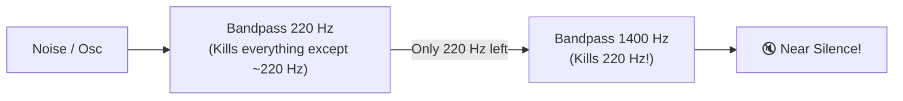
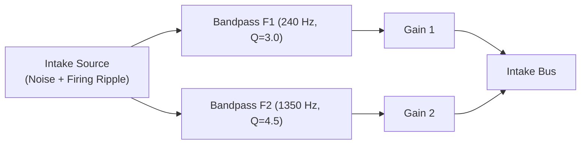
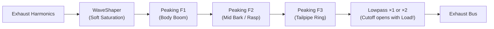

# Chapter 1 (Tier 1): Subtractive DSP, Formant Filtering & Drivetrain Dynamics

## Learning Goals
By the end of this chapter, you will understand from first principles:

1. Why digital oscillators sound "buzzy" and how **harmonics**, **octaves**, and **decibels** work.
2. What a digital **Biquad Filter** is—and how cutoff frequency ($f_c$) and resonance ($Q$) map directly to a car's suspension springs and dampers.
3. **Formant Filters:** What they are physically (the **Source–Filter Model**), why sliding filters sound fake, whether to wire them in **series or parallel**, **how many** you actually need, and **how to tune them** for an I4, VTEC, Straight-6, V8, and 987.2 Flat-6.
4. Why half of engine sound realism in a *parking* simulator lives in the **Drivetrain & Load model** (flywheel inertia, clutch slip, reverse load, and overrun vacuum) rather than the audio nodes alone.

---

## 1.1 DSP From Zero: Waves, Harmonics, and Why Your Current Synth Buzzes

### What Sound Actually Is in Code
Sound in air is tiny, rapid fluctuations in atmospheric pressure pushing on your eardrum. Your browser's Web Audio API represents this pressure wave digitally as a stream of floating-point numbers $x[n] \in [-1.0, +1.0]$, typically sampled **$f_s = 48{,}000$ times per second** ($48\text{ kHz}$).

Every periodic sound can be viewed in two complementary ways:

* **Time Domain ($x[n]$ vs. time):** The shape of the pressure wiggle from millisecond to millisecond (what an oscilloscope draws).
* **Frequency Domain (Amplitude vs. Hz):** The recipe of pure sine waves that add together to make that shape (what the FFT bar graph in [`src/audio_tuner.html`](../src/audio_tuner.html) draws).

Before touching filters, keep two perceptual rules of human hearing in mind—both are **logarithmic**, not linear:

1. **Pitch is perceived in Octaves ($2\times$ frequency):** Going from $50\text{ Hz} \to 100\text{ Hz}$ sounds like the *exact same* musical interval (one octave) as going from $1{,}000\text{ Hz} \to 2{,}000\text{ Hz}$.
2. **Loudness is measured in Decibels ($\text{dB}$):**
   $$\text{dB} = 20 \log_{10}\left(\frac{A_2}{A_1}\right)$$

    - **$+6\text{ dB}$** $\approx 2\times$ the wave amplitude.
    - **$-6\text{ dB}$** $\approx 0.5\times$ the wave amplitude.
    - **$-20\text{ dB}$** $= 0.1\times$ the wave amplitude ($10%$ left).
    - **$-40\text{ dB}$** $= 0.01\times$ the wave amplitude ($1%$ left—nearly inaudible in a mix).

---

### Fourier's Theorem & The Harmonic Series
In 1822, Joseph Fourier proved a remarkable fact: **any** repeating waveform with fundamental frequency $f_0$ (say, $50\text{ Hz}$) is mathematically identical to a sum of pure sine waves at integer multiples of $f_0$:
$$1f_0,\; 2f_0,\; 3f_0,\; 4f_0,\; 5f_0 \dots$$

These multiples are called **harmonics** (or **overtones**). What distinguishes a flute from a brass horn or a buzzing chainsaw playing the exact same $50\text{ Hz}$ pitch is *solely* the relative loudness of those harmonics:

| Web Audio Waveform | Which Harmonics Exist? | Natural High-End Roll-Off | What It Sounds Like Raw |
| :--- | :--- | :--- | :--- |
| **`sine`** | Only $1f_0$ (no overtones) | Infinite (nothing above $f_0$) | Pure tuning fork, hum, sub-bass |
| **`triangle`** | Odd only ($1f_0, 3f_0, 5f_0 \dots$) | Fast: amplitude $\propto \frac{1}{n^2}$ (**$-12\text{ dB/oct}$**) | Mellow, hollow, muted flute |
| **`square`** | Odd only ($1f_0, 3f_0, 5f_0 \dots$) | Slow: amplitude $\propto \frac{1}{n}$ (**$-6\text{ dB/oct}$**) | Clarinet, 8-bit Nintendo |
| **`sawtooth`** | **All** ($1f_0, 2f_0, 3f_0, 4f_0 \dots$) | Slow: amplitude $\propto \frac{1}{n}$ (**$-6\text{ dB/oct}$**) | Bright, raspy, buzzy synthesizer |

### Autopsy of Your Current `AudioController.js`
Open [`src/AudioController.js`](../src/AudioController.js) and look at lines 296–326 and 180–221:

1. For an Inline-6 (`i6`), `setupEngineSound()` spawns **five `sawtooth` oscillators** simultaneously (`1.0x`, `1.5x`, `3.0x`, `4.5x`, `6.0x`). Because *each* sawtooth already contains every integer harmonic ($1, 2, 3 \dots \infty$) rolling off at a gentle $-6\text{ dB/oct}$, stacking five of them floods the spectrum from $20\text{ Hz}$ all the way up to $20{,}000\text{ Hz}$ with phase-locked digital teeth.
2. Next, all five sawtooths feed directly into a nonlinear **`WaveShaperNode` (distortion)**. Waveshaping clips the peaks of the sum, generating *even more* high-frequency harmonics and intermodulation products.
3. Finally, look at what sits between that distortion node and your speakers: **two narrow `notch` filters** at $1{,}000\text{ Hz}$ and $2{,}500\text{ Hz}$, and **zero low-pass filter**. Every harsh harmonic at $3\text{ kHz}, 5\text{ kHz}, 8\text{ kHz}$ hits your ears completely unattenuated!

### Engine Orders vs. Arbitrary `baseFreq`
In automotive acoustics, engineers don't guess a magic `baseFreq: 17` or `baseFreq: 22`—every frequency comes directly from crankshaft geometry:

* **Crankshaft Rotational Frequency ($1\text{st Engine Order}$, or $1\text{E}$):**
  $$f_{\text{rot}} = \frac{\text{RPM}}{60}\;\text{Hz}$$

* **Single-Cylinder Firing Frequency ($0.5\text{E}$, the "Half-Order"):** In a 4-stroke engine (Intake $\to$ Compression $\to$ Power $\to$ Exhaust), each cylinder fires once every **two** crank revolutions:
  $$f_{\text{cyl}} = 0.5 \cdot f_{\text{rot}} = \frac{\text{RPM}}{120}\;\text{Hz}$$

* **Total Engine Firing Frequency ($\frac{N_{\text{cyl}}}{2}\text{E}$):** Across $N_{\text{cyl}}$ cylinders firing evenly over two revolutions:
  $$f_{\text{fire}} = \frac{N_{\text{cyl}}}{2} \cdot f_{\text{rot}} = \frac{\text{RPM} \cdot N_{\text{cyl}}}{120}\;\text{Hz}$$

---

> ### 🤔 Pause & Think 1.1: Physical Engine Orders
>
> 1. Calculate $f_{\text{rot}}$ ($1\text{E}$) and $f_{\text{fire}}$ in Hz for:
>     - An **Inline-4** at $900\text{ RPM}$ idle vs. $6{,}500\text{ RPM}$ redline.
>     - Your **987.2 Cayman S Flat-6** at $950\text{ RPM}$ idle vs. $7{,}400\text{ RPM}$ redline.
>
> 2. Look at `ENGINE_PRESETS.flat6.harmonics` in [`AudioController.js`](../src/AudioController.js): it lists multipliers `[3.0, 1.5, 1.0, 6.0, 0.75]` relative to `baseFreq: 17`. If `baseFreq` represents $f_{\text{rot}}$ at idle ($950 / 60 = 15.83\text{ Hz}$), what physical part of a 6-cylinder boxer engine produces **`3.0x`** vs. **`1.5x`**? *(Hint: think about how the exhaust manifolds on a Flat-6 are arranged!)*

<details>
<summary>💡 Check Your Thinking</summary>

1. **Frequencies:**
    - **Inline-4 ($N_{\text{cyl}} = 4 \implies f_{\text{fire}} = 2 f_{\text{rot}}$):**
        - At $900\text{ RPM}$: $f_{\text{rot}} = 15.0\text{ Hz}$, and $f_{\text{fire}} = 30.0\text{ Hz}$ (right at the bottom of human bass hearing!).
        - At $6{,}500\text{ RPM}$: $f_{\text{rot}} = 108.3\text{ Hz}$, and $f_{\text{fire}} = 216.7\text{ Hz}$.
    - **Flat-6 ($N_{\text{cyl}} = 6 \implies f_{\text{fire}} = 3 f_{\text{rot}}$):**
        - At $950\text{ RPM}$: $f_{\text{rot}} = 15.83\text{ Hz}$, and $f_{\text{fire}} = 47.5\text{ Hz}$.
        - At $7{,}400\text{ RPM}$: $f_{\text{rot}} = 123.3\text{ Hz}$, and $f_{\text{fire}} = 370.0\text{ Hz}$ (roughly F#4 above middle C!).

2. **Physical meaning of `3.0x` vs. `1.5x` on a Flat-6:**
    - **`3.0x` ($3\text{E}$)** is the **combined 6-cylinder firing frequency** (all 6 cylinders merging at the X-pipe/tailpipes: $6 / 2 = 3$ firings per revolution).
    - **`1.5x` ($1.5\text{E}$)** is the **single-bank firing frequency**! A Flat-6 has 3 cylinders on the Left bank and 3 on the Right bank, each feeding its own 3-into-1 exhaust manifold ($3 / 2 = 1.5$ firings per crank revolution per bank). That `1.5E` + `3.0E` interplay is why 6-cylinder engines with split 3-cylinder manifolds have a throatier, deeper undertone than a single-manifold engine! (Meanwhile `0.75x` doesn't exist physically on a 4-stroke—the lowest possible combustion order is `0.5x`, a single cylinder firing once per 2 revolutions.)

</details>

---

## 1.2 Digital Filters & The Suspension Analogy ($f_c$, Slope, and $Q$)

Subtractive synthesis works just like sculpting marble: you start with a harmonically rich raw wave (lots of overtones) and **carve away** the frequencies a physical muffler, intake box, and engine block wouldn't let out.

In Web Audio, `ctx.createBiquadFilter()` gives you a **2nd-order digital filter** ("biquad" because its transfer function is a ratio of two quadratic polynomials—under the hood, it computes each output sample using just 5 multiplications on the current/last 2 input samples and last 2 output samples).

### The Suspension Analogy: What $f_c$ and $Q$ Actually Mean
If you understand how coilover springs and dampers behave on a car, you already understand a 2nd-order `lowpass` filter—**they obey the exact same 2nd-order differential equation!**

Imagine driving over bumps of frequency $f$, where road height is the input wave and car body motion is the output wave:

1. **Cutoff Frequency ($f_c$, `filter.frequency.value` in Hz):** This is the **natural frequency** of the spring-mass system ($\omega_n = \sqrt{k/m}$).
    - Slow highway undulations ($f \ll f_c$): The chassis follows the road $1:1$ (**Passband**, $0\text{ dB}$).
    - Fast cobblestone chatter ($f \gg f_c$): The tire vibrates, but the heavy chassis doesn't have time to move. Above $f_c$, a single 2nd-order `lowpass` filter attenuates energy at **$-12\text{ dB per octave}$** (every time frequency doubles, amplitude drops by $4\times$!).

2. **Quality Factor ($Q$, `filter.Q.value`):** For `lowpass` and `highpass` in Web Audio, this parameter is measured in **decibels of resonant peak** around $f_c$ (note: in textbook physics, dimensionless $Q = \frac{1}{2\zeta}$ where $\zeta$ is the damping ratio; for `bandpass` and `peaking` nodes in Web Audio, `Q` *is* true dimensionless $Q = \frac{f_c}{\text{Bandwidth}}$!).
    - **Flat / Critically Damped (`Q` near `0` dB on Web Audio `lowpass`, or $Q = 0.707$ on `peaking`/`bandpass`):** Like perfectly dialed street dampers—flat response up to $f_c$, zero bounce, smooth roll-off above $f_c$.
    - **High Resonance (High `Q`):** Like removing your shock absorbers and driving on bare springs! Right at $f_c$, energy builds up and **rings louder than the input**, creating a pronounced resonant peak ("boom" or "howl") right at $f_c$.

```
Gain (dB)
 +12 |             /\  <-- High Q (Underdamped: rings/booms at fc!)
     |            /  \
   0 |-----------/----\---------  <-- Flat Q (Smooth passband)
     |                 \
 -12 |                  \   Slope = -12 dB / octave
     |                   \  (Chain two lowpass nodes = -24 dB / octave!)
 -24 |                    \
     +-----------------------------------------> Frequency (log scale)
                fc    2*fc  4*fc
```

### Your Four Workhorse `BiquadFilterNode` Types
*(Check MDN's Web Audio `BiquadFilterNode` reference carefully on `Q` conventions—Web Audio has one quirk worth knowing up front!)*

| `filter.type` | What It Does | Parameters You Set | Acoustic Role in an Engine |
| :--- | :--- | :--- | :--- |
| **`lowpass`** | Passes $< f_c$, cuts $> f_c$ at $-12\text{ dB/oct}$ | `frequency` ($f_c$), `Q` (dB peak at $f_c$, default `0`–`3`) | **Muffler absorption & throttle load** (muffled at idle, opens up under load) |
| **`highpass`** | Cuts $< f_c$, passes $> f_c$ at $-12\text{ dB/oct}$ | `frequency` ($f_c$), `Q` (dB peak) | **Speaker protection / removing sub-25 Hz mud** |
| **`bandpass`** | Passes *only* a band around $f_c$; cuts both below & above at $-6\text{ dB/oct}$ | `frequency` ($f_c$), `Q` ($= f_c / \Delta f$, e.g. `2`–`8`) | **Parallel Formant cavities** (airbox induction howl, narrow pipe mode) |
| **`peaking`** | Leaves flat $0\text{ dB}$ passband, but boosts/cuts a bell around $f_c$ | `frequency` ($f_c$), `Q` ($= f_c / \Delta f$), **`gain`** (dB, e.g. `+10` or `-8`) | **Series Formant body resonances** (muffler boom, metallic mid-pipe rasp) |

---

> ### 🤔 Pause & Think 1.2: Taming the Exhaust Buzz
>
> At $900\text{ RPM}$ idle, your exhaust `WaveShaper` generates nasty high-frequency buzz around **$2{,}400\text{ Hz}$**. Suppose you insert a single `lowpass` `BiquadFilterNode` after the `WaveShaper` with cutoff **$f_c = 300\text{ Hz}$** (flat resonance).
>
> 1. How many **octaves** above $300\text{ Hz}$ is $2{,}400\text{ Hz}$?
> 2. Using the $-12\text{ dB/octave}$ slope of a 2nd-order low-pass filter, by how many **decibels** is that $2{,}400\text{ Hz}$ buzz reduced, and roughly what **percentage** of its original amplitude survives?
> 3. If that still lets through a tiny whisper of fizz on headphones, what happens to the slope if you connect **two** identical `lowpass` nodes in series (`ws -> lp1 -> lp2`)?

<details>
<summary>💡 Check Your Thinking</summary>

1. **Octaves:** $300 \xrightarrow{\times 2} 600 \xrightarrow{\times 2} 1{,}200 \xrightarrow{\times 2} 2{,}400\text{ Hz}$ ($\frac{2400}{300} = 8 = 2^3$). That is **3 octaves**.
2. **Attenuation:** $3\text{ octaves} \times (-12\text{ dB/oct}) = \mathbf{-36\text{ dB}}$.
   In linear amplitude: $10^{-36 / 20} \approx 0.0158$ (or $\frac{1}{8^2} = \frac{1}{64}$)—only **~1.6%** of the harsh $2{,}400\text{ Hz}$ buzz survives, while the fundamental $30\text{–}150\text{ Hz}$ engine note below $300\text{ Hz}$ passes through at **100%** ($0\text{ dB}$)!


3. **Cascading two `lowpass` nodes:** Decibels **add** in series! Two 2nd-order filters create a 4th-order ($-24\text{ dB/oct}$) filter, crushing $2{,}400\text{ Hz}$ by **$-72\text{ dB}$** ($0.025%$ amplitude—dead silent).

</details>

---

## 1.3 What Is a Formant Filter? (The Source–Filter Model)

This brings us to your core question: **What actually *is* a formant filter, and why is it the secret to realistic acoustic synthesis?**

### The Human Voice Experiment
Sing the vowel **"Ahhh"** at a low note, and then slide your pitch smoothly up an octave while still holding **"Ahhh"**. Now repeat the exact same low-to-high pitch slide while singing **"Eeee"**.

Notice two things happened simultaneously:

1. **The Source (Your Vocal Cords)** slid *up* in frequency ($f_0, 2f_0, 3f_0 \dots$ all doubled).
2. **The Filter (Your Throat & Mouth Cavity)** did **NOT** shrink to half its physical size when you sang higher! Because the physical volume and length of your vocal tract stayed constant, its acoustic resonant peaks—called **Formants** ($F_1 \approx 730\text{ Hz}, F_2 \approx 1{,}090\text{ Hz}$ for *"Ahhh"*; $F_1 \approx 270\text{ Hz}, F_2 \approx 2{,}290\text{ Hz}$ for *"Eeee"*)—**stayed fixed in Hz!**

> **Definition:** A **Formant** is a **stationary** (or geometry-dependent, *not* pitch-dependent) resonant peak of a physical acoustic cavity.

### Why Moving Filters Sound Like Cartoon Synths
Look at line 374 of your current [`AudioController.js`](../src/AudioController.js):
```js
intakeFreq: p.intake.filterBase + (absSpeed * p.intake.filterRange)
```
Right now, as `absSpeed` goes from `0` to `1`, your intake bandpass filter slides from `400 Hz` up to `2900 Hz` *in lockstep with RPM*. Physically, that simulates an intake airbox that magically shrinks from the size of a shoebox at idle down to the size of a thimble at redline! When *both* harmonics and filter peaks move together, your ear hears a synthetic "wah-wah" pitch-shift rather than a real metal machine.

In a real car, the **engine block, intake plenum, intake runners, header collectors, and muffler chambers have fixed physical dimensions**:

1. **Helmholtz Resonances ($100\text{–}350\text{ Hz}$):** Just like blowing across the neck of an empty glass bottle, air mass in an intake snorkel bouncing against the springiness of air inside the airbox (or a muffler expansion chamber) rings at a fixed low-mid frequency:
   $$f_H = \frac{c}{2\pi}\sqrt{\frac{A_{\text{neck}}}{V_{\text{cavity}} \cdot L_{\text{neck}}}}$$

2. **Pipe Standing-Wave Modes ($400\text{–}2{,}500\text{ Hz}$):** Intake runners ($30\text{–}50\text{ cm}$) and exhaust mid-pipes ($1.5\text{–}3\text{ m}$) reinforce fixed wavelengths ($f = \frac{c}{4L}$ or $\frac{c}{2L}$).
3. **What creates the "Spine-Tingling Sweep":** As RPM climbs, the engine's harmonics ($1\times, 2\times, 3\times, 4\times f_{\text{fire}}$) **march upward through those fixed formant peaks one after another**. Each time a strong engine harmonic crosses a stationary cavity formant, that harmonic suddenly swells and sings before passing through and handing off to the next harmonic below it!

*(Note: The one exception where a real car's formant *switches* between two fixed frequencies is a physical **variable intake resonance flap**—like Porsche's dual-stage resonance intake manifold on the 987.2 S or BMW's DISA valve—which snaps open a connecting plenum valve around $4{,}200\text{–}5{,}500\text{ RPM}$, shifting the Helmholtz peak between two discrete physical states!)*

---

## 1.4 Engineering Your Formant Bank: Routing, Count & Tuning

### Crucial Trap: Series vs. Parallel Routing!
Suppose you want two formant peaks—one throaty airbox boom at **$220\text{ Hz}$** and one intake runner howl at **$1{,}400\text{ Hz}$**—and you wire two `bandpass` filters in **series**:



**Never chain narrow `bandpass` filters in series!** The first bandpass strips away the frequencies the second bandpass needs. Instead, DSP engineers use one of two clean topologies:

#### Topology A: Parallel `bandpass` Bank (Best for Intake Induction)
Split the source signal into $N$ parallel branches, each with one `bandpass` filter (`frequency` = $F_k$, `Q` = sharpness) and one `GainNode` (weight), then sum them back into a single bus:



* **Why it shines for Intake:** Zero broadband white-noise "hiss" leaks around the peaks—you hear *only* the resonant air column inside the airbox and runners.

#### Topology B: Series `peaking` EQ Chain + Master Load `lowpass` (Best for Exhaust)
Unlike `bandpass`, a **`peaking`** filter passes the base signal through at $0\text{ dB}$ and carves a resonant boost (`+6` to `+14 dB`) or scoop (`-6 dB`) at $F_k$. Because the rest of the spectrum survives, you **can** wire `peaking` nodes cleanly in series, followed by a **Throttle-Load Low-Pass Filter** representing muffler absorption:



* **Why it shines for Exhaust:** You retain the fundamental low-end chest thump below $F_1$, sculpt 2–3 signature metallic/woody resonances in the mids, and use the final `lowpass` cutoff ($f_{\text{LP}}$) to dynamically muffle the sound at idle/coasting ($f_{\text{LP}} \approx 220\text{–}350\text{ Hz}$) and open it up under heavy throttle load ($f_{\text{LP}} \approx 1{,}000\text{–}2{,}400\text{ Hz}$).

---

### How Many Formant Filters Do You Actually Need?
**Short answer: 2 on Intake + 3 on Exhaust (+ 1 or 2 cascaded Exhaust Low-Pass nodes) = 6–7 filter nodes total.**

Why not 10 or 20?

1. Even human speech—the most complex resonant instrument our brains decode—is completely intelligible with just **3 formants ($F_1, F_2, F_3$)**.
2. Web Audio `BiquadFilterNode`s run in native C++/SIMD on the audio thread; 7 biquads take **$< 0.1%$ CPU**. Adding 15 overlapping peaks doesn't cost much CPU, *but* overlapping high-$Q$ boosts sum constructively and turn your mix into muddy, clipping soup.
3. Three well-placed exhaust formants map cleanly to real physical zones you can hear and tune independently:
    - **$F_1$ ($90\text{–}240\text{ Hz}$, $Q \approx 1.5\text{–}3.0$):** **Chest / Muffler Box Boom** (cabin drone & displacement weight).
    - **$F_2$ ($350\text{–}900\text{ Hz}$, $Q \approx 2.5\text{–}5.0$):** **Primary Pipe Character** (woody V8 burble, boxy I4 tone, hollow Flat-6 mid-range).
    - **$F_3$ ($1{,}000\text{–}2{,}400\text{ Hz}$, $Q \approx 3.0\text{–}6.0$):** **Collector Metallic Bite / Wail** (BMW Straight-6 rasp, Porsche high-RPM howl, VTEC scream).

---

### How Do You Tune Them? (Methodology + Starting Recipes)

When you build your formant controls in [`audio_tuner.html`](../src/audio_tuner.html), use the **"Sweep & Lock" studio EQ technique**:

1. **Set the Load Low-Pass first:** With formants flat (`gain = 0 dB`), adjust your idle `lowpass` cutoff until all artificial synth buzz disappears at idle (usually $200\text{–}320\text{ Hz}$), then set your full-throttle `lowpass` ceiling where the engine sounds bright without fizzing ($900\text{ Hz}$ for a lazy V8 up to $2{,}400\text{ Hz}$ for a screaming Flat-6 / VTEC).
2. **Solo-boost one formant at a time:** Crank $F_2$'s gain temporarily to `+15 dB` with `Q = 5`, hold the engine around $3{,}500\text{ RPM}$, and slowly drag $F_2$'s frequency slider until it hits the exact "throatiness" or "metallic rasp" of the car you have in mind. Then pull `gain` back to a natural `+6` to `+10 dB` and widen `Q` (`2.5`–`4.5`) so transitions across RPM feel smooth rather than whistly.
3. **Carve a scoop if it sounds "boxy":** Real exhausts also have destructive acoustic cancellations! Setting one `peaking` node to **`-5 dB` around `300–450 Hz`** removes "cardboard box" muddiness and makes low bass + high metallic wail pop in high contrast.

#### Starting Acoustic Target Table for Your Presets

| Engine Preset | Harmonic Orders (`mult` of $f_{\text{rot}}$) | Exhaust Formants ($F_1 / F_2 / F_3$) | Exhaust Low-Pass (Idle $\to$ WOT) | Intake Formants ($F_{\text{box}} / F_{\text{runner}}$) |
| :--- | :--- | :--- | :--- | :--- |
| **`v8`** *(Land Cruiser / Cross-Plane)* | `0.5x` (0.5), `1.0x` (0.8), `2.0x` (0.6), `4.0x` (0.7) | **$110\text{ Hz}$** (+8 dB, Q=2) · **$260\text{ Hz}$** (+6 dB, Q=2.5) · **$620\text{ Hz}$** (+4 dB, Q=3) | $180\text{ Hz} \to 850\text{ Hz}$ | $160\text{ Hz}$ / $650\text{ Hz}$ |
| **`i4`** *(Mini / Jazz / Jimny)* | `1.0x` (0.25), `2.0x` (0.9), `4.0x` (0.35) | **$145\text{ Hz}$** (+7 dB, Q=2) · **$380\text{ Hz}$** (-4 dB scoop!) · **$780\text{ Hz}$** (+6 dB, Q=3) | $220\text{ Hz} \to 1{,}300\text{ Hz}$ | $220\text{ Hz}$ / $1{,}100\text{ Hz}$ |
| **`civic_vtec`** *(EG B16A)* | `2.0x` (0.85), `4.0x` (0.4), `6.0x` (boosts on VTEC!) | **$165\text{ Hz}$** (+6 dB, Q=2) · **$520\text{ Hz}$** (+5 dB, Q=3) · **$1{,}450\text{ Hz}$** (+9 dB, Q=4.5) | $260\text{ Hz} \to 2{,}200\text{ Hz}$ | $260\text{ Hz}$ / **$1{,}750\text{ Hz}$** (Q=5.5 on VTEC!) |
| **`i6`** *(M3 G80 / E91 / G31)* | `1.5x` (0.45), `3.0x` (0.9), `6.0x` (0.4) | **$155\text{ Hz}$** (+7 dB, Q=2) · **$740\text{ Hz}$** (+8 dB, Q=4) · **$1{,}850\text{ Hz}$** (+7 dB, Q=5, metallic rasp) | $240\text{ Hz} \to 1{,}900\text{ Hz}$ | $210\text{ Hz}$ / $1{,}300\text{ Hz}$ |
| **`flat6`** *(Cayman 987.2 S)* | `1.5x` (0.65), `3.0x` (0.85), `4.5x` (0.25), `6.0x` (0.45) | **$185\text{ Hz}$** (+6 dB, Q=2.2) · **$460\text{ Hz}$** (+5 dB, Q=3, boxer hollow thrum) · **$1{,}150\text{ Hz}$** (+10 dB, Q=4.5, wail) | $250\text{ Hz} \to 2{,}300\text{ Hz}$ | $240\text{ Hz}$ / **$1{,}050\text{ Hz}$ & $2{,}050\text{ Hz}$** |

---

> ### 🤔 Pause & Think 1.3: How Harmonics Excite a Stationary Formant
>
> Suppose on your **Porsche 987.2 S (`flat6`)**, you place a sharp resonant formant peak at **$F_3 = 1{,}050\text{ Hz}$** ($Q = 4.5$). Remember from Pause & Think 1.1 that the Flat-6's fundamental 6-cylinder firing frequency is $f_{\text{fire}} = 3 f_{\text{rot}} = \frac{\text{RPM}}{20}\;\text{Hz}$.
> 1. What RPM would the engine need to spin for the **fundamental** firing frequency ($1 \times f_{\text{fire}}$) itself to reach $1{,}050\text{ Hz}$? Does the Cayman ever reach that RPM?
> 2. Yet in reality, that $1{,}050\text{ Hz}$ formant lights up dramatically during a pull to $7{,}400\text{ RPM}$! Calculate the **exact three RPMs** between $3{,}000\text{ RPM}$ and $7{,}400\text{ RPM}$ where the **6th**, **4th**, and **3rd** harmonics of $f_{\text{fire}}$ ($6 f_{\text{fire}}, 4 f_{\text{fire}}, 3 f_{\text{fire}}$) sweep straight across the $1{,}050\text{ Hz}$ peak!

<details>
<summary>💡 Check Your Thinking</summary>

1. **Fundamental:** $\frac{\text{RPM}}{20} = 1{,}050 \implies \mathbf{21{,}000\text{ RPM}}$ (late-2000s Formula 1 V8 territory!). A road-going 987.2 S redlines at $7{,}400\text{ RPM}$ ($f_{\text{fire}} = 370\text{ Hz}$), so the fundamental *never* gets anywhere near $1{,}050\text{ Hz}$.
2. **Harmonic crossings:** Because your source waveform contains integer harmonics of $f_{\text{fire}}$, each overtone marches through $1{,}050\text{ Hz}$ at a distinct RPM:
    - **6th harmonic ($6 f_{\text{fire}} = 1{,}050 \implies f_{\text{fire}} = 175\text{ Hz}$):** Hits at **$3{,}500\text{ RPM}$**.
    - **5th harmonic ($5 f_{\text{fire}} = 1{,}050 \implies f_{\text{fire}} = 210\text{ Hz}$):** Hits at **$4{,}200\text{ RPM}$** (right around VarioCam / intake flap transition!).
    - **4th harmonic ($4 f_{\text{fire}} = 1{,}050 \implies f_{\text{fire}} = 262.5\text{ Hz}$):** Hits at **$5{,}250\text{ RPM}$**.
    - **3rd harmonic ($3 f_{\text{fire}} = 1{,}050 \implies f_{\text{fire}} = 350\text{ Hz}$):** Screams straight through the peak at **$7{,}000\text{ RPM}$** right before redline!

   *This* is why stationary formants sound magical: a single fixed filter creates a multi-stage evolving vocal "singing" across the rev range as successive harmonics climb the ladder through it!

</details>

---

> ### 🤔 Pause & Think 1.4: Fixing VTEC / VarioCam
>
> In [`AudioController.js`](../src/AudioController.js) line 363, `vtecFreqShift` multiplies all oscillator frequencies by `1.2` when `currentRPM >= 5800`.
>
> Why did that sound jarring, and in your new Tier 1 architecture, which **three parameters** *should* change at the VTEC / VarioCam crossover instead of fundamental pitch?

<details>
<summary>💡 Check Your Thinking</summary>

* **Why `freqShift = 1.2` sounded fake:** Crankshaft speed didn't jump from $5{,}800\text{ RPM}$ to $6{,}960\text{ RPM}$ in $16\text{ ms}$! Shifting oscillator frequency by $1.2\times$ jumps up a musical minor third instantly, breaking physical continuity.
* **What actually changes when switching to the high-lift cam lobe (or opening an intake resonance flap):**
    1. **Upper Harmonic Weights:** Faster, higher valve lift creates a sharper pressure pulse, boosting upper harmonics (`4x`, `6x`) relative to the fundamental (`2x`/`3x`).
    2. **Intake Runner Formant Gain & $Q$:** Deeper volumetric breathing excites the high intake runner formant ($1{,}500\text{–}2{,}000\text{ Hz}$) much more strongly (`screamGain`).
    3. **Exhaust Low-Pass Cutoff & Drive:** Higher mass flow opens up the exhaust brightness (`lowpass` cutoff shifts higher by $+300\text{–}500\text{ Hz}$) and increases waveshaper saturation slightly.

</details>

---

## 1.5 Fixing the Physics-to-Audio Bridge: Drivetrain & Load at Parking Speeds

Even the best DSP sound engine will feel completely disconnected in [`index.html`](../index.html) if you don't fix how [`GameEngine.js`](../src/GameEngine.js) talks to [`AudioController.js`](../src/AudioController.js).

Let's do quick math on your simulator's physical scale (from [`tests/unit/performance.test.js`](../tests/unit/performance.test.js) line 35: `kmh = velocity / 20 * 3.6`, meaning **$20\text{ pixels} = 1\text{ meter}$**):

* When you maneuver into a tight parallel or perpendicular spot, you drive at **$2\text{ to }8\text{ km/h}$** ($11\text{ to }44\text{ px/s}$).
* Compared to `maxSpeed = 340 px/s` ($61.2\text{ km/h}$, roughly top of 1st gear), your `speedRatio` during parking is **`0.03` to `0.13`**.

If `RPM` is just `idleRPM + speedRatio * (redline - idleRPM)`, three things feel wrong during parking:

### Bug 1: Separating Braking from Reverse Engine Load
In [`GameEngine.js`](../src/GameEngine.js), pressing `ArrowDown` sets `input.throttle = -1`:

* If the car is rolling **forward** (`velocity > 2 px/s`) and `input.throttle < 0`, the driver is pressing the **footbrake**, *not* the gas pedal! Engine load should be **zero** (closed throttle).
* Once the car stops or rolls **backward** (`velocity <= 2 px/s`) and `input.throttle < 0`, the car is **in Reverse gear** and the driver is pressing the **accelerator**! Engine load should be **`Math.abs(input.throttle)`** (whereas your old `Math.max(0, throttle)` clamped reverse load to `0`, making backing into a bay dead silent!).

### Bug 2: Clutch Slip / Torque-Converter Flare & Flywheel Inertia
In a real car at $0\text{ km/h}$, if the clutch were rigidly locked to the wheels, $0\text{ km/h}$ would mean $0\text{ RPM}$ (stalled!). Below ~10 km/h ($55\text{ px/s}$), a driver (or automatic torque converter / PDK clutch) **slips the clutch**:

1. When you tap the gas from a standstill, the light flywheel spins up *much faster* than the $1{,}500\text{ kg}$ car—RPM flares immediately to **$1{,}500\text{–}2{,}200\text{ RPM}$** ("blip/bite") while the car barely creeps at $3\text{ km/h}$.
2. As wheel speed catches up above ~10–12 km/h, `wheelDrivenRPM` takes over smoothly up to `redline` in 1st gear (or a shorter Reverse gear ratio, typically ~15% shorter than 1st!).
3. You can model this cleanly with two coupled RPM targets and asymmetric **flywheel inertia** (`dt` smoothing):
    - **`freeRevTarget`**: `idleRPM + engineThrottle * flareRange` (e.g., `flareRange ≈ 1400–1800 RPM` when slipping from a stop).
    - **`coupledWheelRPM`**: `(Math.abs(velocity) / maxGearSpeed) * redline`.
    - **`targetRPM`**: `Math.min(redline, Math.max(idleRPM, coupledWheelRPM, freeRevTarget))` (or a smooth blend as the clutch locks up!).
    - **Flywheel smoothing:** Engine RPM chases `targetRPM` faster when revving up under throttle ($\tau_{\text{up}} \approx 0.08\text{ s}$) than when decaying against internal friction ($\tau_{\text{down}} \approx 0.22\text{ s}$):
     $$\text{rpm} \mathrel{+}= (\text{targetRPM} - \text{rpm}) \cdot \left(1 - e^{-dt / \tau}\right)$$

### Bug 3: Engine Load vs. Overrun (Engine Braking)
Pitch is controlled by **RPM**, but **Timbre & Volume** are controlled by **Manifold Load**:

* **High Load (`engineThrottle > 0`, climbing RPM):** Throttle butterfly is wide open $\to$ loud intake roar, bright exhaust `lowpass` cutoff, high waveshaper drive, deep sub-bass.
* **Overrun / Deceleration (`engineThrottle === 0` while `rpm > idleRPM + 250`):** Throttle butterfly snaps shut! Intake roar drops to **zero** immediately, and exhaust `lowpass` closes down to a dark, hollow vacuum rumble ($200\text{–}300\text{ Hz}$).

### Micro-Imperfection (Breaking the Frozen Robot Idle)
At steady idle, a fixed `900.000 RPM` sounds like an electrical transformer. Adding $\pm 10\text{–}18\text{ RPM}$ of slow organic hunting (e.g., summing two slow sine waves at non-integer frequencies like $1.3\text{ Hz}$ and $3.1\text{ Hz}$, scaled down as RPM rises) plus detuning your mechanical vs. exhaust oscillators by `0.3%` (`1.003x`) creates natural acoustic beating instead of sterile phase-cancellation.

---

> ### 🤔 Pause & Think 1.5: Tracing a Parallel Park Maneuver
>
> Walk through four moments of backing into a spot with your new Drivetrain + Formant model:
>
> 1. **Phase A:** Stationary ($v = 0$), foot off pedals (`input.throttle = 0`).
> 2. **Phase B:** You press `ArrowDown` (`input.throttle = -1`) for $0.3\text{ s}$; car has barely reached $v = -15\text{ px/s}$ ($-2.7\text{ km/h}$).
> 3. **Phase C:** Rolling backward at $v = -40\text{ px/s}$ ($-7.2\text{ km/h}$), you release all keys (`input.throttle = 0`) to coast into the bay.
> 4. **Phase D:** Still rolling backward at $v = -25\text{ px/s}$, you tap `ArrowUp` (`input.throttle = +1`) to brake to a stop.
>
> In **Phase B** vs. **Phase D**, `Math.abs(input.throttle)` is `1.0` in both cases! Which phase should have **high engine load & clutch RPM flare**, and which phase should stay at **zero engine load (idle/overrun)**? Write down the boolean condition on `velocity` and `input.throttle` that distinguishes accelerating from braking!

<details>
<summary>💡 Check Your Thinking</summary>

* **Phase B** (rolling backward or stopped, pressing `ArrowDown`) is **accelerating in Reverse**: `engineThrottle = 1.0` $\implies$ RPM flares on the virtual clutch to ~$2{,}000\text{ RPM}$, intake airbox booms, exhaust low-pass opens up!
* **Phase D** (rolling backward at $-25\text{ px/s}$, pressing `ArrowUp`) is **stepping on the brake pedal**: `engineThrottle = 0.0`! Even though `input.throttle === +1`, it opposes the current motion (`velocity * input.throttle < 0` beyond a small deadzone like `|velocity| > 5 px/s`), so the clutch disengages / throttle stays shut and RPM settles peacefully toward idle instead of roaring!
* **Clean boolean condition (with a small standstill deadzone $\epsilon \approx 5\text{ px/s}$ so you can launch cleanly in either direction):**
  ```js
  const isBraking = Math.abs(velocity) > 5 && Math.sign(input.throttle) !== Math.sign(velocity);
  const engineThrottle = isBraking ? 0 : Math.abs(input.throttle);
  ```

</details>

---

## 1.6 Web Audio Smoothing & Gain Staging Tips

Two quick engineering guardrails before you jump into code:

1. **Always smooth 60 Hz parameter updates with `setTargetAtTime`:**
   Your game loop updates audio 60 times/sec (every $16.7\text{ ms}$), while audio plays at $48{,}000$ samples/sec. Jumping `filter.frequency.value = newFreq` instantaneously creates audible clicks ("zipper noise"). You're already using `param.setTargetAtTime(target, ctx.currentTime, timeConstant)` in `AudioController.js`—keep using it! A `timeConstant` of **`0.02` to `0.04` seconds** reaches $63\%$ of the target in $20\text{–}40\text{ ms}$, eliminating clicks while feeling instantaneous to the driver's foot.

2. **Prevent Resonant Clipping:**
   When a harmonic sits dead-on a `+10 dB` (`3.16x` amplitude!) formant peak, your signal level spikes—just as a real exhaust drones loudly at a specific RPM! Keep `masterGain` sensible (`~0.35–0.5`), or place a `DynamicsCompressorNode` (acting as a transparent brickwall safety limiter: `threshold: -3`, `knee: 6`, `ratio: 12`, `attack: 0.003`, `release: 0.1`) right before `this.analyser` so speaker outputs never hard-clip above `1.0`.

---

## 1.7 Hands-On Coding Lab: Implementing Tier 1 Yourself

Now it's your turn to write the code! Work through these four milestones in order so you can hear and test each improvement incrementally.

### Milestone 1A: Physical Engine Orders & Clean VTEC (`src/AudioController.js`)

1. Replace the arbitrary `baseFreq` math in `calculateState()` with true physical crank rotation frequency:
   $$f_{\text{rot}} = \frac{\text{currentRPM}}{60}$$

2. Interpret each preset's `harmonics[i].mult` as true **Engine Orders** (multiples of $f_{\text{rot}}$, e.g., `2.0` for I4 firing, `1.5` & `3.0` for I6/Flat-6, `0.5`, `1.0`, `2.0`, `4.0` for V8).
3. Remove the musical pitch-jump multiplier (`vtecFreqShift`) on oscillator frequencies! Instead, when `isVtecActive` is true (or smoothly blended over a `300 RPM` transition window around `vtec.rpm`), boost upper harmonic gains (`mult >= 4`), intake runner formant gain, and exhaust low-pass cutoff.

### Milestone 1B: Stateful Parking Drivetrain (`src/EngineSim.js`, `src/AudioController.js` & `src/main.js`)

1. Create a stateful `Drivetrain` helper (either expanding `EngineSim.js` or a dedicated class imported by both `main.js` and `AudioTuner.js`) with `step(dt, velocityPxPerSec, rawThrottleInput)` returning `{ rpm, engineLoad, isOverrun, isReversing, isBraking }`:
    - Implement the braking vs. reverse-load check (`isBraking` when `|velocity| > 5` and `sign(throttle) !== sign(velocity)`).
    - Implement virtual clutch flare from a stop + 1st/Reverse gear ratio coupling (remembering Reverse is ~15% shorter than 1st!) + asymmetric flywheel inertia ($\tau_{\text{up}}$ vs. $\tau_{\text{down}}$).
    - Add subtle idle RPM micro-hunting ($\pm 12\text{ RPM}$ at idle, tapering off above $1{,}500\text{ RPM}$).
2. Update [`tests/unit/audio_logic.test.js`](../tests/unit/audio_logic.test.js) to test:
    - Tapping reverse throttle from standstill raises `rpm` and `engineLoad` (> 0).
    - Pressing opposite throttle while moving (`isBraking`) drops `engineLoad` to `0` rather than flaring the engine.
    - Run `npm test` to verify all unit tests pass!

### Milestone 1C: Formant Filter Bank & Load-Modulated Low-Pass (`src/AudioController.js`)

1. **Exhaust Chain (Topology B):**
    - Replace the hardcoded `1000 Hz` and `2500 Hz` notch filters in `init()` with a configurable array of **3 series `peaking` filters** ($F_1, F_2, F_3$, configured per engine preset in `ENGINE_PRESETS`) followed by **two cascaded `lowpass` filters** (`-24 dB/oct` muffler roll-off).
    - Modulate the `lowpass` cutoff dynamically in `applyState()` using **both** `engineLoad` and `rpm` (dark and muffled at idle/overrun; bright and open under heavy throttle load).

2. **Intake Chain (Topology A):**
    - Route intake noise (plus a touch of firing-order ripple!) into **2 parallel `bandpass` formant filters** ($F_{\text{airbox}}$ and $F_{\text{runner}}$) whose frequencies stay **stationary** in Hz (except an optional plenum resonance switch on `flat6` / `civic_vtec`), gated strictly by `engineLoad`!

3. **Safety Limiter:** Insert a `DynamicsCompressorNode` before `this.analyser` so high-$Q$ formant sweeps never clip.

### Milestone 1D: Upgrade the Audio Tuner Lab (`src/audio_tuner.html` & `src/AudioTuner.js`)

1. Add sliders in `audio_tuner.html` for your Exhaust Low-Pass range and Formant frequencies/gains/$Q$ so you can use the **"Sweep & Lock"** method live while watching the FFT canvas.
2. Add a **"PARKING CREEP / BLIP"** scenario button next to `"GENEROUS REV"` and `"ENGINE BRAKING"` that blips throttle `0 -> 0.6 -> 0 -> -0.5 -> 0` at low speeds so you can tune clutch flare and parking character directly in the tuner.
3. Export your tuned JSON presets back into `ENGINE_PRESETS` in `AudioController.js`, then test every car inside [`index.html`](../index.html)!

---

*Once your Tier 1 Drivetrain and Formant Cabinet are singing, open **[Chapter 2 (Tier 2): Crankshaft Phase, Cylinder Pressure Pulses & 1D Waveguides](./chapter_02_tier2_pulses_and_waveguides.md)** to replace those continuous oscillators with true 48 kHz cylinder combustion pulses!*
