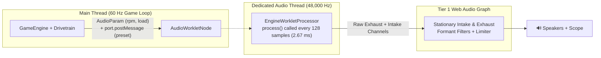
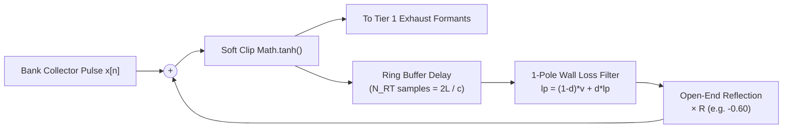

# Chapter 2 (Tier 2): Crankshaft Phase, Cylinder Pressure Pulses & 1D Waveguides

## Learning Goals
By the end of this chapter, you will understand from first principles:

1. Why continuous oscillators hit a realism ceiling at idle and low RPM, and how Web Audio's **`AudioWorklet`** lets you write real-time $48{,}000\text{ Hz}$ sample-by-sample physics in plain JavaScript.
2. How to track **crankshaft angle $\theta \in [0, 4\pi)$** across a $720^\circ$ 4-stroke cycle without pitch-warp bugs or sample-grid aliasing.
3. **What a single cylinder pulse actually sounds like:** Why 1-sample clicks sound like Geiger counters, and how to synthesize a **zero-DC biphasic exhaust blowdown pulse** + turbulent gas "chuff" whose shape naturally brightens under load.
4. Why firing orders and manifold geometry make a **Cross-Plane V8 burble** while a **987.2 Flat-6 howls**—even when their cylinders fire cleanly.
5. How a 20-line **1D Acoustic Waveguide** (circular delay line + inverted open-tailpipe reflection + damping filter) turns dry puffs into a resonant metallic exhaust pipe ($f = \frac{c}{4L}$).

---

## 2.1 Why Leave Oscillators Behind? The Duty-Cycle Problem

After completing Tier 1, your engines will already sound dramatically warmer and react properly to parking maneuvers. Yet if you listen closely at **idle ($850\text{–}950\text{ RPM}$)** or **slow parking creep ($1{,}200\text{ RPM}$)**, you will still notice a subtle "synthesizer" smoothness. Why?

Because `OscillatorNode` generates a **continuous, 100%-duty-cycle periodic wave**:
```
Sawtooth Oscillator at 30 Hz (33 ms period):
  /|  /|  /|  /|     <-- Continuous ramp filling all 33 ms of every cycle
 / | / | / | / |

Real Cylinder Exhaust Port at 900 RPM (33 ms between firings):
 /\          /\      <-- Sharp 3 ms pressure explosion, followed by
   \________/  \___      ~30 ms of resonant pipe ringdown & near-silence!
```

At $850\text{ RPM}$, your ear does **not** hear a continuous $28\text{ Hz}$ bass guitar note—human hearing resolves events separated by $> 25\text{ ms}$ as **discrete percussive chugs** (*"chug-chug-chug"*). As RPM climbs past ~$1{,}800\text{ RPM}$ ($< 15\text{ ms}$ between pulses), those discrete explosions overlap in the exhaust pipe and naturally fuse into a continuous pitched roar!

Continuous Web Audio oscillators cannot:

1. Change the **duty cycle** (ratio of pulse width to cycle period) as RPM rises.
2. Fire **unevenly spaced** cylinder intervals (like one bank of a Cross-Plane V8).
3. Vary **individual** explosions randomly from cycle to cycle (combustion variance and overrun pops).

To unlock all three at once, we step down from the 60 Hz Node Graph into the **$48{,}000\text{ Hz}$ Sample Loop** via `AudioWorklet`.

---

## 2.2 `AudioWorklet` in 5 Minutes: Sample-By-Sample Audio

Web Audio runs across two threads so UI work or garbage collection on the main thread never causes audio dropouts:



Inside your `AudioWorkletProcessor`, the browser calls `process(inputs, outputs, parameters)` **375 times per second**, handing you a tiny `Float32Array(128)` ($128 / 48000 = 2.67\text{ ms}$ of audio) to fill:

```js
// Boilerplate shell of src/EngineWorklet.js (Web Audio API plumbing — not the DSP!)
class EngineWorkletProcessor extends AudioWorkletProcessor {
    static get parameterDescriptors() {
        return [
            { name: 'rpm', defaultValue: 900, minValue: 0, maxValue: 18000, automationRate: 'a-rate' },
            { name: 'load', defaultValue: 0, minValue: 0, maxValue: 1, automationRate: 'a-rate' }
        ];
    }

    constructor() {
        super();
        // Pre-allocate all typed arrays & state here (ZERO 'new' allocations inside process()!)
        this.port.onmessage = (e) => this.applyPreset(e.data);
    }

    process(inputs, outputs, parameters) {
        const outExhaust = outputs[0][0]; // Channel 0: Exhaust
        const outIntake  = outputs[0][1]; // Channel 1: Intake (optional stereo/2-bus split!)
        const rpmArr  = parameters.rpm;
        const loadArr = parameters.load;

        for (let i = 0; i < outExhaust.length; i++) {
            const rpm  = rpmArr.length > 1 ? rpmArr[i] : rpmArr[0];
            const load = loadArr.length > 1 ? loadArr[i] : loadArr[0];
            // ---> YOUR 48 kHz ENGINE PHYSICS GOES RIGHT HERE <---
        }
        return true; // Keep processor alive
    }
}
registerProcessor('engine-worklet', EngineWorkletProcessor);
```

> **Golden Rule of Real-Time DSP:** Never allocate objects (`{}`, `[]`, `new Float32Array`) inside the `for (let i = 0; i < 128; i++)` sample loop! Allocate small fixed-size arrays (e.g., max 8 cylinders, fixed ring buffers) once in `constructor()`, and mutate numbers in place so the JS garbage collector never runs on the audio thread.

---

## 2.3 Crankshaft Phase Accumulator & 4-Stroke Geometry

### Classic Beginner Bug: Never Multiply Frequency by Time!
When programmers first write a variable-pitch wave in a loop, they are tempted to write `Math.sin(2 * Math.PI * freq * currentTime)`. **Never do this when `freq` changes over time!** By the product rule of calculus, the instantaneous frequency (derivative of phase $2\pi f(t) \cdot t$) becomes $f(t) + t \cdot \frac{df}{dt}$—meaning after 60 seconds of play, tapping the gas multiplies pitch wildly by $60\times$!

Instead, just like integrating `pos += velocity * dt` in [`GameEngine.js`](../src/GameEngine.js), you integrate **crankshaft angle $\theta$** incrementally by a tiny step $\Delta\theta$ each sample:

$$\Delta\theta = 2\pi \cdot \frac{\text{RPM}}{60 \cdot f_s}\quad\text{(radians per sample)}$$

Because a **4-stroke Otto cycle** (Intake $\to$ Compression $\to$ Power $\to$ Exhaust) takes **two full crankshaft revolutions**, our repeating cycle wraps at **$4\pi\text{ radians}$ ($720^\circ$)**, not $2\pi$:

$$\theta[n] = \big(\theta[n-1] + \Delta\theta\big) \bmod 4\pi$$

Each cylinder $k \in \{0 \dots N_{\text{cyl}}-1\}$ has a fixed **Exhaust Valve Opening (EVO) trigger angle** $\theta_k \in [0, 4\pi)$.

### Wrap-Safe Trigger Detection & Free Sub-Sample Accuracy
How do you know if cylinder $k$ just opened its exhaust valve on the current sample? Compute the wrapped angular distance $\phi_k \in [0, 4\pi)$ *ahead* of cylinder $k$'s trigger angle:

$$\phi_k = (\theta - \theta_k + 4\pi) \bmod 4\pi$$

* If **$\phi_k < \Delta\theta$**, the crankshaft **just crossed $\theta_k$ during this exact sample!**
* Even better: $\Delta t_{\text{sub}} = \frac{\phi_k}{\Delta\theta \cdot f_s}$ tells you the *exact sub-sample fraction of a sample* ago that the valve cracked open! Starting your pulse envelope at $t = \Delta t_{\text{sub}}$ instead of $t = 0$ eliminates high-RPM sample-grid quantization buzz (aliasing) in two lines of arithmetic!

---

> ### 🤔 Pause & Think 2.1: Crankshaft Sample Math
>
> Assume $f_s = 48{,}000\text{ Hz}$ (`sampleRate` in Web Audio).
>
> 1. How many audio samples elapse during one complete $720^\circ$ ($4\pi$) 4-stroke cycle at **$900\text{ RPM}$ idle** vs. **$7{,}200\text{ RPM}$ redline**?
> 2. At $7{,}200\text{ RPM}$, by how many **degrees** does the crankshaft rotate in a *single* audio sample? Why would checking `if (Math.abs(theta - theta_k) < 0.0001)` skip almost every cylinder firing?

<details>
<summary>💡 Check Your Thinking</summary>

1. **Samples per $720^\circ$ cycle:**
    - At **$900\text{ RPM}$**: $f_{\text{rot}} = 15\text{ rev/s} \implies 7.5$ full $720^\circ$ cycles/sec. $\frac{48{,}000}{7.5} = \mathbf{6{,}400\text{ samples}}$ per 4-stroke cycle.
    - At **$7{,}200\text{ RPM}$**: $f_{\text{rot}} = 120\text{ rev/s} \implies 60$ full $720^\circ$ cycles/sec. $\frac{48{,}000}{60} = \mathbf{800\text{ samples}}$ per 4-stroke cycle.

2. **Degrees per sample at $7{,}200\text{ RPM}$:**
    - $\frac{720^\circ}{800\text{ samples}} = \mathbf{0.9^\circ\text{ per sample}}$ ($\Delta\theta \approx 0.0157\text{ rad}$).
    - Because $\theta$ leaps by $0.0157\text{ rad}$ each sample, it will almost *never* land within `0.0001` of `theta_k`—your engine would misfire 99% of the time! Checking `phi_k < dTheta` catches **100%** of crossings across every RPM, including right across the $4\pi \to 0$ boundary.

</details>

---

## 2.4 Does Each Pulse Have Sound? Synthesizing a Single Exhaust Blowdown

Now for your central Tier 2 question: **When a single cylinder fires, what sound does *one* isolated pulse make, and how do we generate it mathematically?**

Yes—each cylinder event is literally a miniature **uncorked champagne pop** inside the exhaust port! Let's build up the exact waveform of a single pulse in three steps so you see why naive pulses fail and why a physical blowdown wavelet works wonders.

### Attempt 1 (Naive): The 1-Sample Digital Spike (`[1, 0, 0, 0...]`)
What if you output `1.0` on the trigger sample and `0.0` everywhere else?
In DSP, a 1-sample spike ($0.02\text{ ms}$ wide) is a **Dirac Delta Impulse**. Its Fourier transform is a **perfectly flat horizontal line**: it contains *equal* energy at $50\text{ Hz}$, $1{,}000\text{ Hz}$, $10{,}000\text{ Hz}$, and $24{,}000\text{ Hz}$! A train of 1-sample clicks sounds like an **electric taser or Geiger counter**, not a combustion engine.

### Attempt 2 (Flawed): A Purely Positive Pressure Hump
What if each valve opening outputs a smooth $2\text{ ms}$ positive bump $p(t) \ge 0$?
Because every sample is positive, the **average value (DC offset)** is strictly greater than zero—and as RPM climbs from $900$ to $7{,}000\text{ RPM}$, $8\times$ as many positive bumps pack into each second! That rising DC offset shoves your speaker cone steadily outward toward `1.0`, eating up all your headroom and distorting asymmetrically.

### Attempt 3 (Physical Reality): The Zero-DC Biphasic Blowdown Wave + Turbulent Chuff
Look at the actual gas dynamics when an exhaust valve cracks open (~$45^\circ$ before Bottom Dead Center):

1. **The Compression Front ($0 \to 0.5\text{ ms}$):** Residual cylinder pressure ($5\text{–}8\text{ bar}$ at full throttle; $\sim 1.3\text{ bar}$ at idle) blasts past the valve seat, launching a steep **positive pressure crest** down the header primary.
2. **Scavenging Rarefaction ($0.5\text{ ms} \to 4\text{ ms}$):** Momentum of the fast-moving gas column over-expands the port (exhaust scavenging!), creating a broader, shallower **negative pressure trough** behind the crest. Furthermore, when that pulse exits the open tailpipe into outside air, acoustic radiation pressure is proportional to the *time derivative* of volume velocity ($p_{\text{rad}} \propto \frac{dU}{dt}$)—meaning **a radiated acoustic pulse always has equal positive and negative area (zero DC offset)**!
3. **Turbulent Shear "Chuff":** Supersonic gas shearing through the narrow valve gap injects a brief puff of band-limited **turbulent flow noise** riding on the crest of the pulse.

```
Pressure p(t) of ONE Cylinder Exhaust Blowdown Pulse:

  +1.0 |    /\      <-- Steep positive blowdown shock (+ turbulent gas noise)
       |   /  \
   0.0 +--+----\----------------------> time t (ms)
       |        \      ________
 -0.34 |         \____/        ^-- Broader scavenging rarefaction trough
                                   (Positive area == Negative area -> Zero DC!)
```

### A Clean, Exact Equation You Can Code in 4 Lines
Consider the normalized dimensionless wavelet $w(u)$ where $u = \frac{t}{\tau_0} \ge 0$, controlled by a single characteristic blowdown time constant **$\tau_0$** (in seconds):

$$w(u) = 2.17 \cdot u(2 - u)e^{-u} \quad\text{for } 0 \le u \le 10 \;\;(\text{and } 0 \text{ for } u > 10)$$

Look at the properties this tiny formula gives you for free:

* **Zero click at $t = 0$:** $w(0) = 0$ (ramps up smoothly as the valve cracks open).
* **Asymmetric blowdown punch:** Peaks sharply at $u \approx 0.59$ ($w \approx +1.0$), crosses zero at $u = 2.0$, dips into a wide scavenging trough of $-0.34$ at $u \approx 3.41$, and decays to $< 0.008$ by $u = 10$.
* **Mathematically guaranteed Zero DC Offset at *every* RPM:**
  $$\int_0^\infty u(2 - u)e^{-u}\,du = 2\int_0^\infty u e^{-u}\,du - \int_0^\infty u^2 e^{-u}\,du = 2(1!) - 2! = 2 - 2 = \mathbf{0}$$

* **Adding Turbulent Gas Chuff:** Mix in a touch of filtered white noise gated by the positive blowdown crest ($u < 2$) and scaled by `load`:
  $$p_{\text{total}}(u) = A_{\text{load}} \cdot \Big[ w(u) + k_{\text{turb}} \cdot \text{load} \cdot \max(0, w(u)) \cdot \text{noise}[n] \Big]$$

### How Load & RPM Shape $\tau_0$ Naturally
Why does an engine bark sharply under full throttle, purr softly at idle, and sound tight at high RPM? **Because $\tau_0$ changes physically!**

* **At Idle / Low Load (`load ≈ 0.05`):** Low cylinder blowdown pressure $\implies$ lazy, wide pulse (**$\tau_0 \approx 0.9\text{–}1.3\text{ ms}$**, total tail $\sim 10\text{ ms}$). Smooth, wide pulses naturally lack harsh high frequencies!
* **Under Full Throttle (`load = 1.0`) & High RPM:** High cylinder pressure + fast valve opening $\implies$ crisp, narrow shock (**$\tau_0 \approx 0.25\text{–}0.45\text{ ms}$**, total tail $\sim 3\text{ ms}$) with $4\text{–}6\times$ larger amplitude $A_{\text{load}}$. Narrower pulses automatically pack punchy mid/high harmonics into the headers!

### Superposition (When Pulses Overlap at High RPM)
Each cylinder $k$ tracks the elapsed time $t_k$ since its most recent EVO trigger (if active, i.e., $t_k < 10\tau_0$). At each sample, you simply advance `t_k += 1 / sampleRate` for each cylinder and **sum** their active pressures into the manifold! Zero dynamic arrays needed—just a fixed loop of length $N_{\text{cyl}} \le 8$.

---

> ### 🤔 Pause & Think 2.2: Pulse Width vs. Brightness
>
> Without writing any filter at all, imagine listening to two isolated pulses:
>
> - **Pulse A** has $\tau_0 = 1.2\text{ ms}$ (positive crest lasts $2\tau_0 = 2.4\text{ ms}$).
> - **Pulse B** has $\tau_0 = 0.3\text{ ms}$ (positive crest lasts $2\tau_0 = 0.6\text{ ms}$).
>
> Roughly what half-wave sine frequency corresponds to a $2.4\text{ ms}$ crest vs. a $0.6\text{ ms}$ crest? Why does shrinking $\tau_0$ when you floor the accelerator pedal automatically brighten the engine's timbre *before* any EQ filter?

<details>
<summary>💡 Check Your Thinking</summary>

* A half-cycle lasting $2.4\text{ ms}$ corresponds to a full period of $4.8\text{ ms} \implies f \approx \frac{1}{0.0048} \approx \mathbf{208\text{ Hz}}$! Energy above a few hundred Hz rolls off naturally because a wide, gentle wave cannot wiggle fast enough to excite $2\text{ kHz}$ air vibrations.
* Shrinking the crest $4\times$ to $0.6\text{ ms}$ corresponds to a full period of $1.2\text{ ms} \implies f \approx \mathbf{833\text{ Hz}}$, extending strong harmonic energy up past $2{,}000\text{ Hz}$!
* In physics and Fourier analysis, this is the **Time–Frequency Scaling Property**: compressing a pulse in time by $4\times$ stretches its frequency spectrum upward by $4\times$! That means load-dependent $\tau_0$ gives you organic harmonic brightening straight from thermodynamics.

</details>

---

## 2.5 Firing Orders, Bank Geometry & Why V8s Burble While Flat-6s Howl

Here is one of the coolest payoffs in procedural audio: **once you model per-cylinder pulses and dual-bank manifolds, engine character emerges directly from real mechanical blueprints!**

Let's compare the $720^\circ$ ($4\pi$) crank trigger schedules across your presets:

### 1. Inline-4 (`i4`, `civic_vtec`) — Firing Order `1-3-4-2`

* **EVO Angles:** $[0^\circ,\; 180^\circ,\; 360^\circ,\; 540^\circ]$ (even $\pi\text{ rad}$ spacing into a single 4-into-1 collector).
* **Acoustic signature:** Strong $2\text{E}$ pulse train. *(Fun experiment: if you add $35\text{ cm}$ of extra runner pipe delay to two cylinders on one side, your I4 instantly transforms into a **Subaru WRX unequal-length Boxer-4** off-beat rumble!)*

### 2. BMW Straight-6 (`i6`) — Firing Order `1-5-3-6-2-4`

* **Bank / Manifold split:**
    - **Front Manifold (`Cyl 1, 3, 2`):** Fires at **$0^\circ,\; 240^\circ,\; 480^\circ$** ($240^\circ$ spacing).
    - **Rear Manifold (`Cyl 5, 6, 4`):** Fires at **$120^\circ,\; 360^\circ,\; 600^\circ$** ($240^\circ$ spacing, alternating `Front-Rear-Front-Rear` every $120^\circ$!).
* **Why BMW splits `1-2-3` and `4-5-6`:** Grouping Front 3 and Rear 3 into separate downpipes prevents adjacent blowdown pulses from spoiling cylinder scavenging before they merge downstream at the mid-pipe resonator with a slight $15\text{–}30\text{ cm}$ path difference.

### 3. Porsche 987.2 S Flat-6 (`flat6`) — Firing Order `1-6-2-4-3-5`

* **Bank split:**
    - **Left Bank (`Cyl 1, 2, 3`):** Fires at **$0^\circ \text{ (Cyl 1)},\; 240^\circ \text{ (Cyl 2)},\; 480^\circ \text{ (Cyl 3)}$**.
    - **Right Bank (`Cyl 6, 4, 5`):** Fires at **$120^\circ \text{ (Cyl 6)},\; 360^\circ \text{ (Cyl 4)},\; 600^\circ \text{ (Cyl 5)}$**.
* **Why a Cayman sounds completely different from a single-pipe 6-cylinder:** Left and Right banks travel through **two independent headers, catalytic converters, and muffler chambers**, meeting only at an acoustic balance tube / dual center tailpipe! If Left and Right pipes reach the listener's ears with even a tiny acoustic path asymmetry ($0.3\text{–}0.8\text{ ms}$, or stereo panning!), the $1.5\text{E}$ bank pulses and $3\text{E}$ combined pulses create that unmistakable hollow boxer thrum at $2{,}000\text{ RPM}$ that locks into a spine-tingling 6-cylinder wail above $4{,}500\text{ RPM}$!

### 4. Cross-Plane V8 (`v8`) — Classic Firing Order `1-8-4-3-6-5-7-2`
Look closely at which bank (`L` = Left `1,3,5,7`; `R` = Right `2,4,6,8`) fires every $90^\circ$:

| Crank Angle | $0^\circ$ | $90^\circ$ | $180^\circ$ | $270^\circ$ | $360^\circ$ | $450^\circ$ | $540^\circ$ | $630^\circ$ |
| :--- | :---: | :---: | :---: | :---: | :---: | :---: | :---: | :---: |
| **Cylinder** | 1 | 8 | 4 | 3 | 6 | 5 | 7 | 2 |
| **Bank** | **L** | **R** | **R** | **L** | **R** | **L** | **L** | **R** |

Look at **Left Bank alone**: it fires at **$0^\circ \to 270^\circ \to 450^\circ \to 540^\circ \to (720^\circ)$**.
The angular gaps inside the Left exhaust pipe are:
$$270^\circ \;-\; 180^\circ \;-\; \mathbf{90^\circ} \;-\; 180^\circ$$
Two cylinders (`5` then `7` on Left; `8` then `4` on Right) fire back-to-back **$90^\circ$ apart ("double-hit")**, followed by a huge **$270^\circ$ pause** in that pipe! *That* `L - R - R - L - R - L - L - R` bank bunching is **100% of why an American / Land Cruiser Cross-Plane V8 burbles like a motorboat**, whereas a Ferrari Flat-Plane V8 (`L - R - L - R - L - R - L - R`) screams smoothly like two synced Inline-4s!

---

> ### 🤔 Pause & Think 2.3: Avoiding the "Silent V8 Cancel-Out" Trap
>
> Suppose you code the exact Cross-Plane V8 `L-R-R-L-R-L-L-R` table above, compute Left Bank's pulses `leftSum` and Right Bank's pulses `rightSum`, and then immediately write `const monoOut = leftSum + rightSum;` with identical pulse parameters and zero pipe delay difference.
>
> 1. What happens to the uneven `270° - 180° - 90° - 180°` burble when `leftSum` and `rightSum` are added together instantaneously with identical waveguides?
> 2. Name **two realistic physical mechanisms** in a dual-exhaust car that keep Left Bank and Right Bank distinct so your ear clearly hears the V8 burble even on mono laptop speakers!

<details>
<summary>💡 Check Your Thinking</summary>

1. **Instantaneous identical sum collapses the burble!** Because `{0°, 270°, 450°, 540°} ∪ {90°, 180°, 360°, 630°}` equals `{0°, 90°, 180°, 270°, 360°, 450°, 540°, 630°}`, summing two identical linear banks with zero delay/nonlinearity erases the bank distinction and leaves a completely uniform $90^\circ$ ($4\text{E}$) hum!
2. **Two physical mechanisms that preserve the burble in real life (and in your code!):**
    - **Per-Bank Nonlinearity & Waveguide State:** Each bank has its *own* header collector waveguide and nonlinear gas compression (`Math.tanh(...)` saturation) *before* meeting outside! Two pulses bunched $90^\circ$ apart inside the Left header overlap and saturate differently than two pulses split across Left and Right pipes.
    - **Acoustic Path-Length Asymmetry (and/or Stereo Panning):** On virtually every V8 (especially transverse routing around a transmission/transfer case like a Land Cruiser, or standing slightly off-axis from dual tailpipes), one bank's exhaust path to the listener is **$25\text{–}70\text{ cm}$ ($0.7\text{–}2.0\text{ ms}$, or $35\text{–}95$ samples)** longer than the other, and in headphones you can pan Left Bank slightly left (`-0.25`) and Right Bank slightly right (`+0.25`)!

</details>

---

## 2.6 1D Acoustic Waveguides: Putting a Metal Pipe Around Your Pulses

If you listen to your raw zero-DC blowdown pulses directly, they sound like an **un-piped lawnmower cylinder firing into open air**—percussive, crisp, and engine-like, *but* missing the hollow, metallic "tubiness" of headers and tailpipes.

How do we simulate a $2\text{ m}$ steel exhaust pipe at $48{,}000\text{ Hz}$ without solving partial differential equations? With a **1D Digital Waveguide**—which is just a **circular delay buffer (`Float32Array`) + a 1-line reflection filter**!

### Step 1: Pipe Length = Sample Delay ($N$)
Sound in hot exhaust gas ($\sim 350\text{–}500^\circ\text{C}$) travels much faster than in room-temperature air ($343\text{ m/s}$) because speed of sound scales with $\sqrt{T_{\text{Kelvin}}}$:
$$c_{\text{exhaust}} \approx 480\text{ m/s}$$

For a pulse to travel down a pipe of length $L$ meters and reflect back to the collector (a round trip of $2L$ meters), the delay in audio samples is:
$$N_{\text{RT}} = \text{round}\!\left(\frac{2L}{c_{\text{exhaust}}} \cdot f_s\right)$$
For example, a **$1.0\text{ m}$** pipe at $c = 480\text{ m/s}$ and $f_s = 48{,}000\text{ Hz}$ is a round-trip delay of just **$N_{\text{RT}} = 200$ floats** in a circular `Float32Array`!
*(In code, you don't shift array elements every sample: you keep one integer cursor `idx`, read the oldest sample `const delayed = buf[idx]`, overwrite `buf[idx] = newSample` in the exact same slot, and advance `idx = (idx + 1) % N_RT`—an $O(1)$ delay line!)*

### Step 2: Why an Open Tailpipe Reflects Waves *Upside Down* ($R < 0$)
Here is a classic acoustics surprise: how can sound *reflect* off the **open end** of an empty tailpipe when there is no wall there?

Inside the narrow steel pipe, the gas pulse is confined by rigid walls (high acoustic impedance). The instant it hits the open tailpipe exit, it suddenly expands into the vast 3D atmosphere (low acoustic impedance), clamping gauge pressure toward $0$. By momentum conservation, that sudden pressure drop sucks a **negative (sign-inverted) rarefaction wave** ($R \approx -0.55\text{ to }-0.72$) *backward* up the tailpipe toward the engine!

### Step 3: High-Frequency Wall Losses (1-Pole Low-Pass in the Loop)
Higher frequencies dissipate faster against muffler perforations and pipe walls than low bass. Inside an `AudioWorklet`, you don't have `BiquadFilterNode`, so you write the simplest filter in all of DSP—a **1-pole Exponential Moving Average (EMA)**:
```js
lpState = (1 - d) * delayed + d * lpState;
```

* **Why is a weighted average a low-pass filter?** For a slow $80\text{ Hz}$ bass wave, adjacent samples at $48\text{ kHz}$ are nearly identical, so `lpState` tracks the wave $1:1$. For a rapid $12\text{ kHz}$ hiss (`+1, -1, +1, -1`), blending the new sample with previous opposite-sign samples averages it out toward `0`!
* **How to pick `d` without guessing:** Given a desired wall-loss cutoff frequency $f_{\text{wall}}$ in Hz (e.g., $1{,}800\text{–}3{,}500\text{ Hz}$):
  $$d = e^{-2\pi \cdot f_{\text{wall}} / f_s}$$



> **⚠️ Critical Stability Invariant:** The feedback reflection magnitude **must strictly satisfy $|R| < 1.0$** (in practice, keep $R \in [-0.75, -0.35]$). If $|R| \ge 1.0$, each echo returns *louder* than the last, exploding exponentially to `NaN` in milliseconds! Wrapping the pipe sum in `Math.tanh(x)` adds realistic high-pressure gas compression *and* guarantees the waveguide can never blow up.

*(Bonus Header Detail: You can also give each individual cylinder primary runner a tiny non-feedback delay line of $35\text{–}75\text{ cm}$ before summing into the Bank Waveguide! Varying those 4 or 6 runner lengths by even $3\text{–}8\text{ cm}$ gives realistic collector phase texture.)*

---

> ### 🤔 Pause & Think 2.4: Connecting Your Ring Buffer to Classical Pipe Physics!
>
> Suppose your bank exhaust waveguide has a round-trip buffer length of **$N_{\text{RT}} = 200\text{ samples}$** at $f_s = 48{,}000\text{ Hz}$ (representing a $L = 1.0\text{ m}$ pipe at $c = 480\text{ m/s}$), and an inverting open-tailpipe reflection of **$R = -0.6$**.
> 1. You inject a positive spike `+1.0` at sample `0`. What comes back at sample `200`? At what sample does the echo flip back to **positive (`+0.36`)** so it reinforces the original polarity?
> 2. Using that positive-to-positive period (in samples), calculate the waveguide's **fundamental resonant frequency $f_1$ in Hz**!
> 3. Compare your answer to the classical physics textbook formula for a pipe closed at one end (the cylinder head) and open at the other (the tailpipe)—a **quarter-wave resonator**, $f_1 = \frac{c}{4L}$!

<details>
<summary>💡 Check Your Thinking</summary>

1. **Echo polarity:** At sample `200` (1 round trip), the echo returns inverted: **`-0.60`**. After a *second* round trip at **sample `400`**, $-0.60 \times -0.60 = \mathbf{+0.36}$—back in positive phase!
2. **DSP frequency from buffer size:** A full positive-to-positive cycle takes $400\text{ samples}$ at $48{,}000\text{ samples/sec}$:
   $$f_1 = \frac{48{,}000}{400} = \mathbf{120\text{ Hz}}$$
   (And because alternate half-cycles invert, it reinforces **odd harmonics only**: $120\text{ Hz}, 360\text{ Hz}, 600\text{ Hz}\dots$—giving that unmistakable hollow, woody pipe resonance!)

3. **Physics textbook check:**
   $$f_1 = \frac{c}{4L} = \frac{480\text{ m/s}}{4 \times 1.0\text{ m}} = \mathbf{120\text{ Hz}}$$
   Your 4-line ring buffer `Float32Array(200)` with negative feedback *is* the exact time-domain solution to the 1D acoustic wave equation of a quarter-wave exhaust pipe!

</details>

---

## 2.7 Breathing Life Into the Machine: Jitter, Intake Gulp & Overrun Burbles

With crank pulses, dual-bank geometry, and 1D pipe waveguides working, three final micro-details elevate Tier 2 from "impressive simulation" to **visceral**:

### 1. Cycle-to-Cycle Combustion Stochasticity
In a real cylinder, air-fuel mixing and spark kernel growth vary slightly on *every single explosion*. Whenever cylinder $k$ crosses its EVO trigger (`phi_k < dTheta`), randomize that individual pulse's amplitude and width slightly:

* **Pulse Amplitude Jitter:** $A_k = A_{\text{base}} \cdot (1 + \text{rand}(-0.07, +0.07))$ (wider variance $\pm 12\%$ at idle when combustion is cooler/lazier; tighter $\pm 4\%$ under full load).
* **Pulse Width Jitter:** $\tau_k = \tau_0 \cdot (1 + \text{rand}(-0.05, +0.05))$.
Because every cylinder stroke excites the waveguide slightly differently, the engine never sounds "looped" even if you let it idle for 5 minutes!

### 2. Intake Induction Pulses (Why Wide-Open Throttle Growls From the Front)
Intake sound isn't just continuous white-noise hiss—every time an **Intake Valve Opens (IVO)** ($360^\circ = 2\pi\text{ rad}$ offset from EVO) and the piston plunges down, it sucks a sharp **negative pressure gulp** out of the intake plenum!

* **Crucial physical gate:** Between the intake plenum and outside air sits the **throttle butterfly valve**.
    - When `load === 0` (closed throttle), the metal throttle plate blocks the sound from escaping out the snorkel $\implies$ intake pulse gain $\approx 0$.
    - As `load -> 1.0` (wide-open throttle), you get an unobstructed acoustic shot straight down the intake runners to the intake valves! Feeding those IVO pulses into your Tier 1 parallel Intake Formants ($F_{\text{airbox}}$ + $F_{\text{runner}}$) produces true induction bark (especially on the 987.2 S Cayman and B16 Civic VTEC!).

### 3. Lift-Off Overrun Burbles
When you rev past $2{,}800\text{ RPM}$ and suddenly snap the throttle shut (`load === 0`, `isOverrun === true`), manifold vacuum spikes and tiny pockets of unburnt fuel ignite late in the hot exhaust manifold:

* During overrun, normal cylinder pulses become very soft and wide (low pressure, large $\tau_0 \approx 1.3\text{ ms}$).
* With a small per-firing probability (say `p = 0.04` to `0.12` while `rpm > 2500` on sporty presets like `m3_g80` or `cayman_987`, tapering to `0` near idle), trigger a single sharper, medium-amplitude delayed pop inside one bank's waveguide! Because it passes through the exact same exhaust pipe waveguide and formant filters, it sounds like an organic exhaust burble rather than a canned sound effect.

---

> ### 🤔 Pause & Think 2.5: Overrun Physics Check
>
> Suppose you rev the `flat6` up to $5{,}500\text{ RPM}$ under full throttle (`load = 1.0`), and then abruptly lift your foot completely off the gas (`load = 0.0`).
> Contrast what happens **immediately** (within $30\text{ ms}$, while RPM is still ~$5{,}400	ext{ RPM}$!) to:
>
> 1. The **Intake** channel output, vs.
> 2. The **Exhaust** channel's pulse rate, pulse amplitude $A$, and pulse width $\tau_0$!

<details>
<summary>💡 Check Your Thinking</summary>

1. **Intake channel:** Drops **immediately to near-silence** within $20\text{–}30\text{ ms}$ even though the engine is still spinning at $5{,}400\text{ RPM}$, because the throttle butterfly plate physically slammed shut!
2. **Exhaust channel:**
    - **Pulse rate:** Still firing at the $5{,}400\text{ RPM}$ rate ($270\text{ pulses/sec}$) as the car's momentum/flywheel spins the crank!
    - **Pulse amplitude $A$ & width $\tau_0$:** Because fuel is cut (or minimal) and manifold pressure is deep vacuum, cylinder blowdown pressure plummets—so $A$ drops to ~15–20% of full-throttle level and $\tau_0$ widens from ~$0.3\text{ ms}$ to ~$1.1\text{ ms}$ (plus occasional random overrun burble pops), producing that smooth, hollow, decelerating engine-braking purr down the rev range!

</details>

---

## 2.8 Hands-On Coding Lab: Implementing Tier 2 Yourself

Time to build your real-time 48 kHz engine! Keep your Tier 1 **Drivetrain** and **Stationary Formant Filters**—you are only replacing the `OscillatorNode` bank inside [`src/AudioController.js`](../src/AudioController.js).

### Milestone 2A: `AudioWorklet` Plumbing & Async Init (`src/EngineWorklet.js` & `src/AudioController.js`)

1. Create `src/EngineWorklet.js` defining `EngineWorkletProcessor` with `rpm` and `load` `AudioParam`s and a stereo (2-channel) output: Channel `0` = Exhaust raw waveguide out, Channel `1` = Intake raw induction out (split via `ctx.createChannelSplitter(2)` into your Tier 1 Exhaust Formants and Intake Formants!).
2. Update `AudioController.init()` to `async init()` using:
   ```js
   await this.ctx.audioWorklet.addModule(new URL('./EngineWorklet.js', import.meta.url));
   ```
   *(Tip: Remember to serve over `npm start` / `http://localhost:8080`, as browsers block `AudioWorklet` over `file://`. Also guard `if (typeof AudioWorkletProcessor !== 'undefined')` in `EngineWorklet.js` if you want to import and unit-test your pure pulse/waveguide math classes inside Jest!)*

### Milestone 2B: $720^\circ$ Crank Accumulator & Firing Tables (`src/EngineWorklet.js`)

1. Implement the $0 \dots 4\pi$ phase accumulator and wrap-safe sub-sample crossing detector (`phi_k < dTheta`).
2. Add cylinder EVO angle + bank assignment (`0` = Left/Front, `1` = Right/Rear) configurations for:
    - `i4` / `civic_vtec` (`[0, 180, 360, 540]` deg)
    - `i6` (`[0, 120, 240, 360, 480, 600]` deg, split across Front 3 / Rear 3 banks)
    - `flat6` (`1-6-2-4-3-5`, Left vs. Right banks)
    - `v8` (`1-8-4-3-6-5-7-2`, Cross-Plane Left vs. Right banks!)
   *(Keep your existing smooth sine/harmonic path as a fallback for `ev`!)*

### Milestone 2C: Zero-DC Blowdown Pulse, Turbulent Chuff & Jitter

1. Implement your fixed-size per-cylinder pulse state (`active`, `elapsedSec`, `amp`, `tau0`) with **zero heap allocations** inside `process()`.
2. Evaluate the zero-DC biphasic blowdown wavelet $w(u) = 2.17 \cdot u(2 - u)e^{-u}$ + load-gated turbulent noise burst (generate a fast Xorshift PRNG or pre-filled noise table inside the worklet constructor!).
3. Add per-firing random combustion jitter ($\pm 6\%$ amplitude, $\pm 4\%$ $\tau_0$) and load-modulated $\tau_0$ (wide at idle/overrun, crisp under load, plus optional VTEC cam-profile $\tau_0$ sharpening above `vtec.rpm`!).

### Milestone 2D: Dual-Bank 1D Pipe Waveguides & Overrun Burble

1. Write a small, reusable `PipeWaveguide` class (pre-allocated `Float32Array` ring buffer, write index, 1-pole wall-loss filter state, open-end negative reflection $R \in [-0.70, -0.45]$, and `Math.tanh` saturation).
2. Give **Bank 0** and **Bank 1** slightly different pipe lengths (e.g., `1.15 m` vs. `1.48 m` on `v8`; `0.95 m` vs. `1.08 m` on `flat6` / `i6`) so dual-bank interference and V8 burble come alive even in mono!
3. Add intake IVO pulses on Channel `1` (gated by `load`) and probabilistic lift-off overrun burbles when `isOverrun && rpm > 2500`.

### Milestone 2E: Add an Oscilloscope Toggle & "Single Spark" Test to `audio_tuner.html`!
To *see* and *hear* your time-domain physics from the ground up, add two tiny controls in [`src/audio_tuner.html`](../src/audio_tuner.html) & [`src/AudioTuner.js`](../src/AudioTuner.js):

1. **A `"SINGLE PULSE (1 SPARK)"` debug button** (sends `{ type: 'single_spark' }` over `workletNode.port.postMessage` when the engine is stopped):
    - Listen to **one isolated cylinder blowdown** pop and ring down inside your $1\text{ m}$ exhaust pipe waveguide!

2. **An `[FFT Spectrum | Oscilloscope]` visualizer toggle** using `audio.analyser.getByteTimeDomainData(dataArray)`:
    - Drag RPM slowly from a slow-motion **`120 RPM`** crank up through **`900 RPM`** idle to **`7,000 RPM`** redline—hear the exact threshold where discrete percussive cylinder pops fuse into a continuous engine note!
    - At $850\text{ RPM}$ idle on **`i4`**, watch evenly spaced biphasic blowdown crests + inverted quarter-wave pipe echoes decay cleanly between firings.
    - Switch to **`v8`** and watch the `L - R - R - L` double-hit bunching dance across the oscilloscope while you hear the V8 burble!
    - Blip the throttle and watch the pulses compress narrower ($\tau_0 \downarrow$), grow taller, and pack closer together into a screaming high-RPM howl!
